# Hotel Loyalty Points Mall

## Project Report

> A hotel loyalty points management and redemption system implemented with Spring Boot, JSP, MyBatis, H2, Spring Security, and embedded Artemis JMS.

**Project:** CS6451 Advanced Software Design  
**Application:** `hotel-loyalty`  
**Version:** `0.0.1-SNAPSHOT`  
**Java:** 21  
**Build:** Maven  
**Last reviewed:** 26 October 2026

---

## 1. Executive Summary

Hotel Loyalty is a web application for managing a hotel's guest loyalty points and points-mall products. It supports two authenticated user roles:

- **Guest**: signs in, views the points mall, checks the current balance, selects a product, chooses a supported payment method, and redeems the product.
- **Manager**: signs in through the manager portal, manages points-mall products, manages points rules, and manually adds points to a normal guest account.

The current implementation combines server-rendered JSP pages for the user interface with REST endpoints for browser-side administration and guest operations. Business logic is kept in service classes, database access is isolated in MyBatis mappers, and Spring Security controls role-based access.

The implementation also demonstrates several software-design techniques:

1. **Layered architecture**: controller, service, mapper, and persistence layers.
2. **Strategy pattern**: payment validation is selected through `PaymentStrategyFactory`.
3. **State pattern**: order lifecycle states are represented by the classes in the `order` package.
4. **Message-driven processing**: manual point adjustments are sent to an embedded Artemis queue and processed asynchronously.
5. **Optimistic concurrency control**: point balances and stock are updated with compare-and-update operations.

### Architecture diagrams

The implemented package flow is shown in [`layered_architecture.svg`](UML/layered_architecture.svg).

The payment design is a **Strategy pattern**, shown in [`payment_strategy_uml.svg`](UML/payment_strategy_uml.svg).
It is not a Chain of Responsibility: `PaymentStrategyFactory` selects exactly one strategy from
`PaymentTypeEnum`, and strategies do not pass an unhandled request to one another. The controller and
service call the selected strategy directly.

The asynchronous points-adjustment flow and its reliability controls are shown in
[`message_driven_points_adjustment.svg`](UML/message_driven_points_adjustment.svg). The manager request
is validated and placed on the persistent `queue.points.adjustment` Artemis queue. The listener updates
the user balance and writes the transaction. An exception rolls back processing and causes redelivery;
the optimistic compare-and-update also turns concurrent balance conflicts into retryable failures.

This report describes the implemented system rather than the original conceptual model. Where a use case or UML artifact describes planned behavior that is not yet connected to the running code, it is explicitly marked as a gap.

---

## 2. Business Scenario

Hotel guests earn and spend loyalty points. The hotel publishes redeemable products in a points mall, such as benefits or hotel-related rewards. A guest can use points alone or use a combination of points and another instrument, currently cash or voucher.

Managers maintain the product catalogue and the rules used to describe how points are earned. They can also manually award points to a guest. Manual awards are queued so that temporary processing failures do not cause the request to be lost.

The main business invariants are:

- A guest must be authenticated and must access only their own resources.
- A manager-only operation must not be available to a guest.
- A redemption cannot use more points than the guest owns.
- A redemption cannot use an unavailable product.
- Remaining stock must not become negative.
- A product with active orders cannot be deleted.
- Every redemption and manual award creates a signed points transaction.

---

## 3. Scope and Use Cases

The use-case catalogue contains six primary use cases.

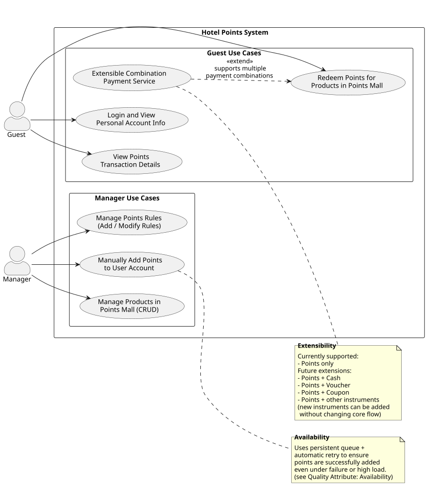

| ID | Use case | Current implementation |
|---|---|---|
| UC1 | Guest login and personal account information | **[Implemented]** Login, session identity, user ID, name, role, status, level, balance, registration time, and account page are implemented |
| UC2 | View points transaction details | **[Implemented]** My Points displays signed history, type, related order, timestamp, and redemption orders |
| UC3 | Redeem points for products in the points mall | **[Implemented within simulated-payment scope]** Points, simulated cash, and simulated voucher flows validate and persist orders |
| UC4 | Manager manages points rules | **[Partially implemented / key gap]** Rule CRUD works; **hotel-order points calculation and award processing are not connected** |
| UC5 | Manager manually adds points | **[Core implemented / partially complete]** Persistent queue, consumer, retry, balance update, and EARN transaction work; **queue status, dead-letter handling, request status, and reason persistence are not implemented** |
| UC6 | Manager manages products | **[Core implemented / partially complete]** Product CRUD and validation work; **guest-facing inventory availability needs further presentation support** |

### Implementation status at a glance

The following items are the **key incomplete or not-yet-implemented features** and should not be described as fully delivered:

- **UC1:** No known missing item within the current use-case scope. The account page exposes every field currently stored for the user: ID, name, role, status, level, current points, and registration time.
- **UC3:** No missing item within the agreed prototype scope. Cash and voucher are intentionally simulated; real provider integration is explicitly out of scope.
- **UC4 — Rule execution:** managers can maintain rules, but no hotel-order earning event selects a rule and calculates/awards points.
- **UC5 — Operational queue management:** there is no user-facing queued/processed/retrying/failed status, durable request ID, dead-letter administration, or persisted adjustment reason.
- **UC6 — Availability presentation:** the backend filters available products, but the guest-facing product view does not expose a complete stock/availability state for every product.
- **Order lifecycle orchestration:** order state classes exist, but the redemption service currently persists status transitions directly; cancellation, fulfilment, and shipment workflows are not implemented.

### UC1 - Login and account information

The application provides separate login pages:

- `/login` for guests
- `/admin/login` for managers

Authentication uses Spring Security sessions and BCrypt passwords. The current guest points page displays the guest name, level, balance, registration time, and redemption records. The account page exposes all stored account fields: user ID, name, role, status, membership level, current points, and registration time. **UC1 is complete for the current data model and viewing scope.**

### UC2 - Points transaction details

The database and mapper support transaction history through `PointsTransactionMapper.selectByUid`. Redemption and manual-award flows also create `PointsTransactionDO` records. `MyPointsVO` and `guest_my_points.jsp` expose the complete signed transaction history in the Points History tab:

- transaction date;
- positive or negative points change;
- transaction type (`EARN` or `REDEEM`);
- related order ID, when applicable.

### UC3 - Redeem products

The guest redemption flow is implemented by `GuestPointsServiceImpl`:

1. Load and validate the guest and product (including an in-stock pre-check).
2. Validate the selected payment strategy.
3. Create a pending order.
4. Atomically deduct points with an optimistic balance check (compare-and-update).
5. Settle the non-points portion through `PaymentGateway` (simulated cash charge or voucher redemption).
6. Mark the order as paid through the `OrderContext` state pattern with a compare-and-update status transition.
7. Insert a negative points transaction linked to the order.
8. Publish a `PointsDeductedEvent`; `RewardDistributionListener` runs synchronously inside the same transaction and deducts one unit of product stock as the reward-distribution step.

The My Redemptions tab reads the same paid order records through `OrderMapper.selectByUid`, so
points-only, cash, and voucher redemptions are all represented after successful completion.

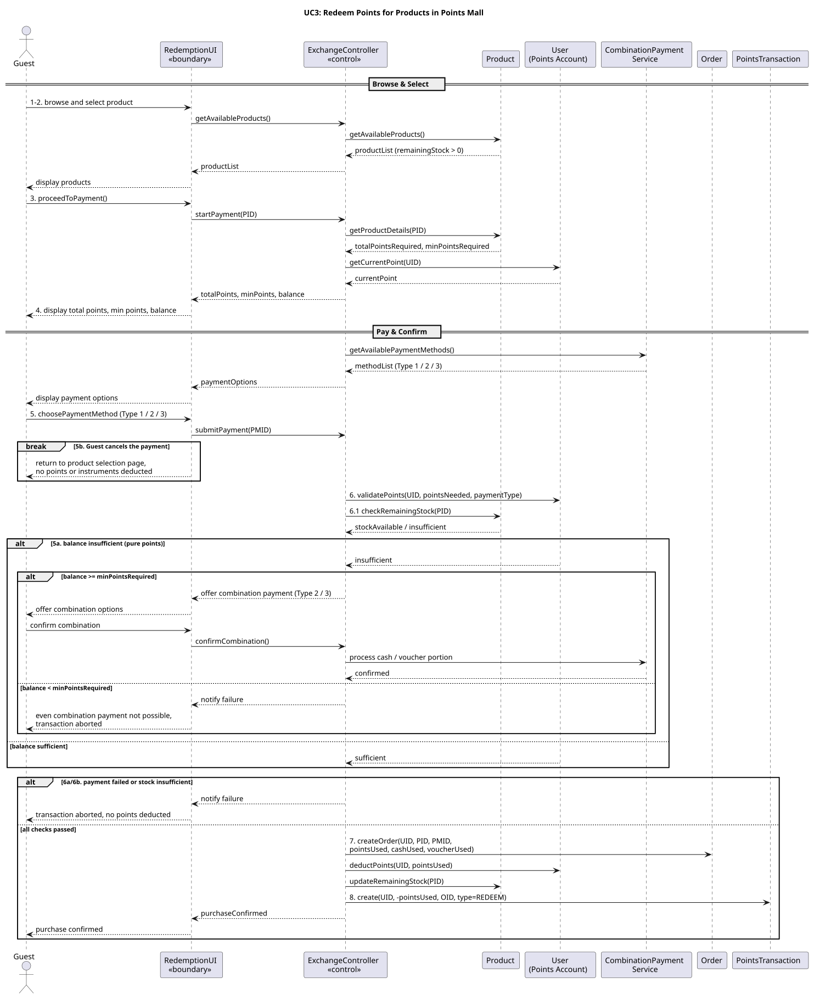

The supported payment strategies are:

- points only;
- points plus cash;
- points plus voucher.

The cash and voucher interactions are intentionally simulated for this academic prototype.
Real external payment authorization, capture, refund, timeout reconciliation, and provider-failure
handling are **out of scope**, not incomplete implementation work.

### UC4 - Manage points rules

Managers can list, create, and update rules. The service validates rule type and the time range for period rules. Level rules clear the threshold because they do not use a minimum external order amount.

The rule data is currently stored and managed, but no external hotel-order earning process in this application consumes the rules to calculate newly earned points. The management part of UC4 is therefore implemented; **the subsequent calculation and award integration is not implemented**.

### UC5 - Manually add points

Managers verify a target user, enter a positive point amount, and optionally provide a reason. The request is sent to the persistent Artemis queue. `PointsAdjustmentConsumer` updates the balance and creates an `EARN` transaction. Exceptions cause message redelivery, providing automatic retry behavior.

The optional reason is currently written to the application log rather than persisted in `points_transaction`, whose schema has no reason column. **There is also no queue-status API, durable request ID, dead-letter administration, or user-facing retry status.**

### UC6 - Manage products

Managers can:

- create a product;
- list products;
- retrieve product details;
- update product information and stock;
- delete a product when it has no active orders.

On creation, `remainingStock` is initialized to `totalStock`. The service validates that minimum points do not exceed total points and that remaining stock does not exceed total stock. **The guest-facing catalogue currently filters unavailable products rather than presenting a complete availability status.**

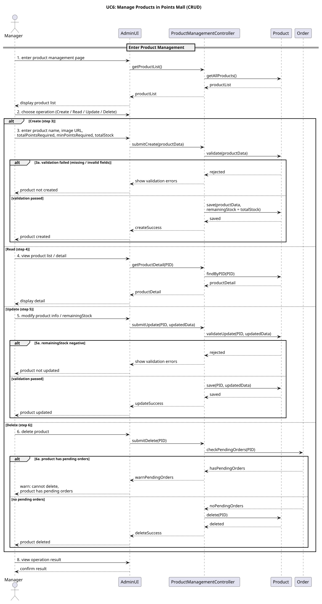

---

## 4. Functional Architecture

The application follows a layered web architecture:

```text
JSP pages / REST clients
          |
          v
Controllers
          |
          v
Application services
          |
          v
MyBatis mappers
          |
          v
H2 database
```

The asynchronous manual-award path is:

```text
Manager UI
    |
    v
PointsAdjustmentController
    |
    v
PointsAdjustmentService
    |
    v
Artemis queue
    |
    v
PointsAdjustmentConsumer
    |
    +--> UserMapper
    |
    +--> PointsTransactionMapper
```

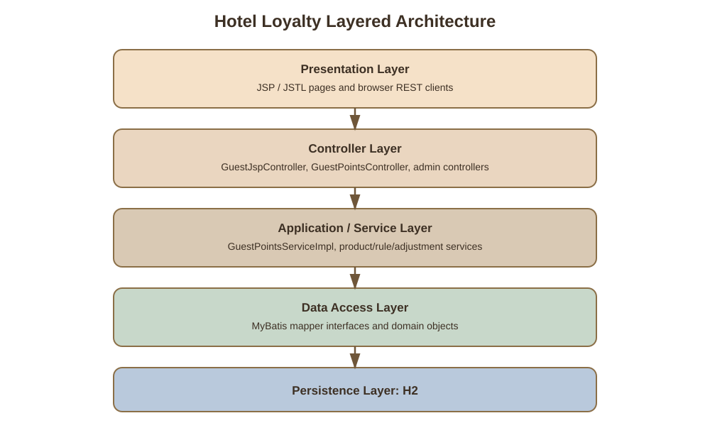

### Main packages

| Package | Responsibility |
|---|---|
| `controller` | REST endpoints and JSP page controllers |
| `service` | Application service interfaces |
| `service.impl` | Business rules and transaction orchestration |
| `domain` | Persistence/domain objects |
| `dto` | Validated request payloads |
| `vo` | View and API response objects |
| `mapper` | MyBatis data-access interfaces |
| `payment` | Payment strategy abstractions and implementations |
| `messaging` | Artemis producer, consumer, messages, and events |
| `order` | Order state abstraction |
| `security` | Authentication, login flow, and role handling |
| `config` | Spring Security and JMS configuration |

---

## 5. Design Patterns

### 5.1 Layered architecture

Controllers do not directly implement persistence logic. For example:

```text
ProductManagementController
        -> ProductManagementService
        -> ProductMapper
        -> ProductDO
```

This keeps HTTP concerns separate from business validation and database access.

See [`layered_architecture.svg`](UML/layered_architecture.svg) for the package-level diagram.

### 5.2 Strategy pattern for payment

`PaymentStrategy` defines the validation contract. The concrete strategies are:

- `PointsOnlyStrategy`
- `PointsPlusCashStrategy`
- `PointsPlusVoucherStrategy`

`PaymentStrategyFactory` selects a strategy by `PaymentTypeEnum`. A new payment instrument can therefore be added as another strategy without changing the main redemption orchestration.

The class relationship and concrete implementations are shown in
[`payment_strategy_uml.svg`](UML/payment_strategy_uml.svg). This is not a Chain of Responsibility:
there is no sequential handler chain, fallback handler, or `next` reference.

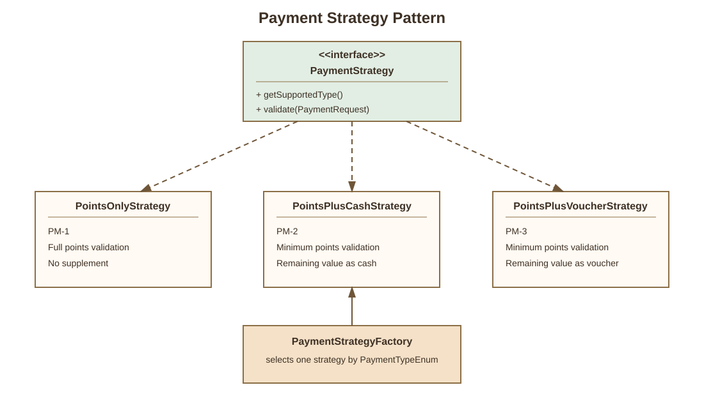

### 5.3 State pattern for orders

The `order` package contains:

- `OrderState`
- `PendingPaymentState`
- `PaidState`
- `CompletedState`
- `CancelledState`
- `OrderContext`

The current guest redemption service persists order status directly as part of the redemption transaction. The state classes provide the model for order lifecycle behavior and can be expanded as cancellation and fulfilment workflows are added.

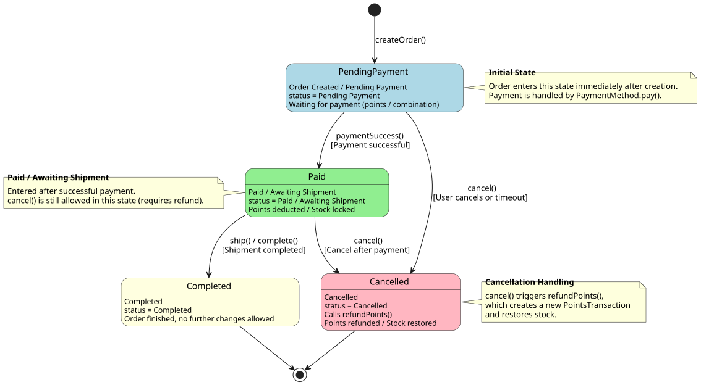

### 5.4 Message-driven processing

Manual point awards are decoupled from the manager request through Artemis JMS. The producer acknowledges the request by enqueueing it, while the consumer performs the balance update and transaction insert. An exception allows the broker to redeliver the message.

The queue, producer, consumer, database writes, and retry path are shown in
[`message_driven_points_adjustment.svg`](UML/message_driven_points_adjustment.svg). Persistent delivery,
listener rollback/redelivery, and optimistic locking provide the implementation's reliability mechanism;
there is no claim of exactly-once processing beyond the current transaction and message configuration.

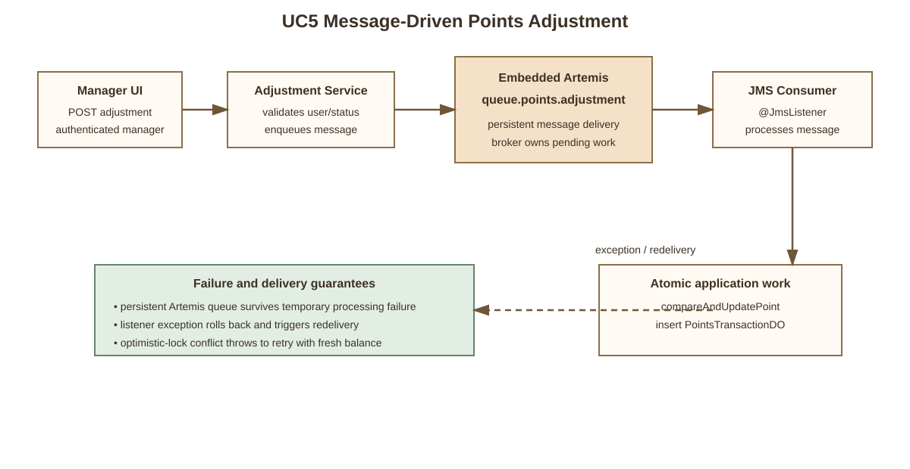

### 5.5 Optimistic concurrency

Point and stock updates use conditional database updates. A redemption fails if the stored balance or stock changed between the initial read and the update. This prevents two concurrent requests from spending the same points or stock unit.

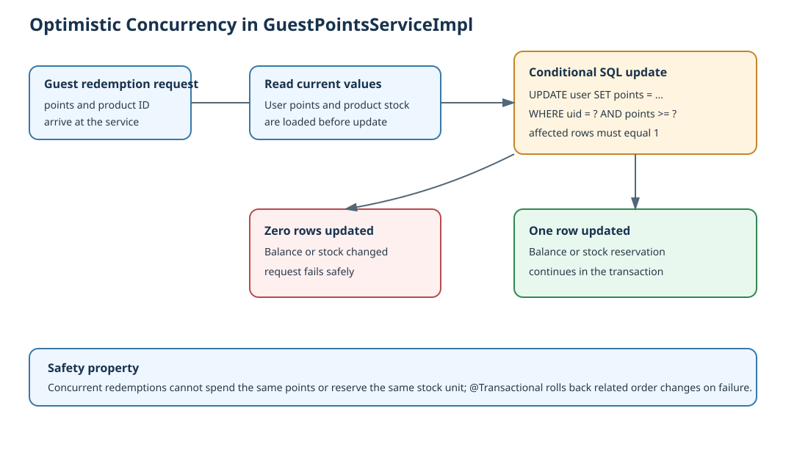

### 5.6 Chain of Responsibility for post-login checks

The security package contains a hand-written Chain of Responsibility for business checks that
run after Spring Security has authenticated the password:

```text
StatusCheckHandler
        -> PortalMatchHandler
        -> LoginLogHandler
        -> RedirectHandler
```

Each `LoginPostHandler` performs one check and passes the shared `LoginContext` to its successor.
Returning `false` interrupts the chain. This is separate from Spring Security's framework
`SecurityFilterChain`; the project-owned chain handles application-specific status, portal,
logging, and redirect decisions.

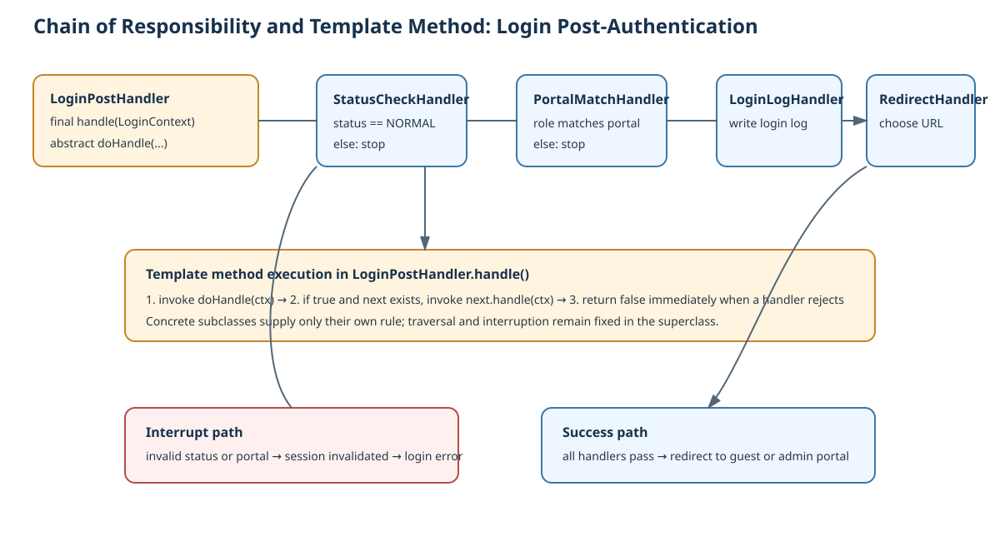

### 5.7 Template Method in login handlers

`LoginPostHandler.handle()` is a final template method. It executes the common control flow
(run the current handler, then invoke the successor when the check passes), while concrete
handlers implement the variable `doHandle()` step. This keeps chain traversal consistent and
limits each handler to one business rule.

### 5.8 Observer / publish-subscribe event handling

`RewardDistributionListener` and `PointsDeductedEvent` provide an active application-level
Observer / publish-subscribe flow. When `GuestPointsServiceImpl.redeem` finishes deducting
points, settling payment, and recording the order, it publishes a `PointsDeductedEvent`.
`RewardDistributionListener` observes the event and deducts one unit of product stock as the
reward-distribution step, keeping reward distribution separate from point deduction. Spring's
synchronous `@EventListener` executes the listener inside the publisher's transaction, so the
stock deduction participates in the same redemption transaction — atomicity is preserved while
the logic stays decoupled (Open/Closed Principle). Additional listeners, such as notification
or voucher issuance, can subscribe to the same event without touching the redemption service
or this listener.

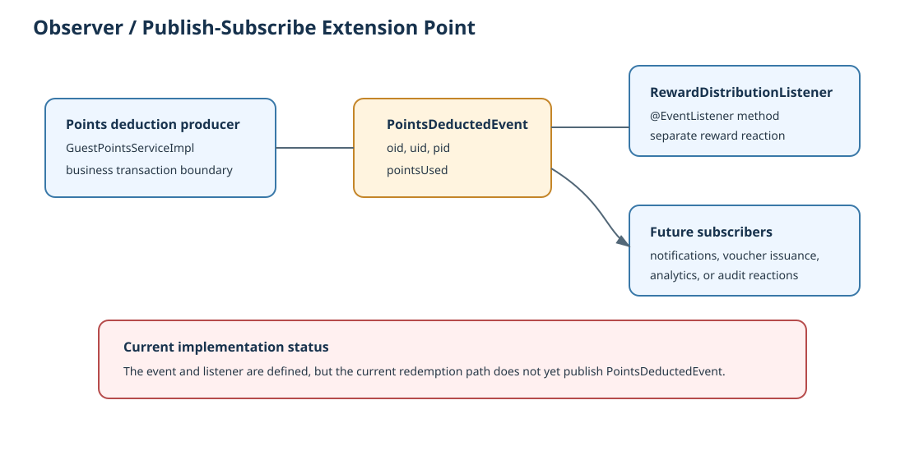

### 5.9 Factory and Data Mapper patterns

`PaymentStrategyFactory` is a Factory object that resolves a payment strategy from
`PaymentTypeEnum`. The MyBatis mapper interfaces (`UserMapper`, `ProductMapper`,
`OrderMapper`, and others) implement the Data Mapper pattern: persistence operations are
kept outside the domain objects and services.

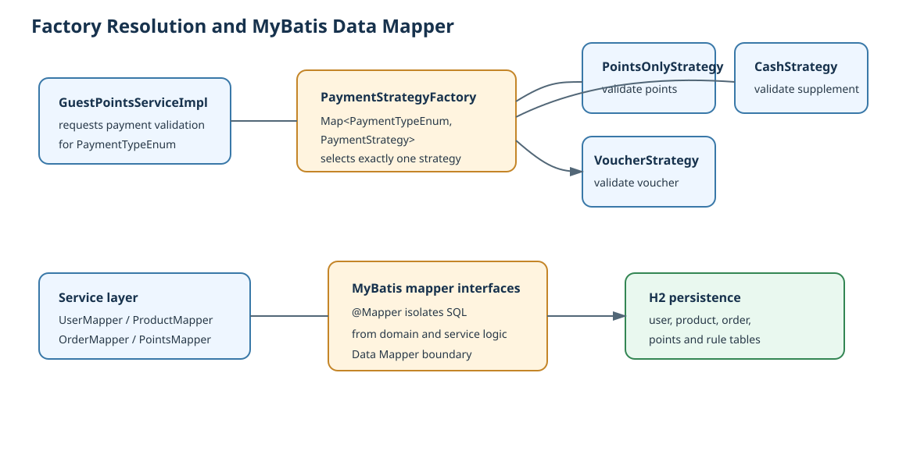

### 5.10 MVC and dependency injection

The JSP controllers and REST controllers provide the Model-View-Controller separation:
controllers handle requests, services provide application behavior, and JSP pages or
`Result` objects provide the view/response. Constructor injection is used throughout the
controllers, services, producers, consumers, and listeners, making dependencies explicit
and testable.

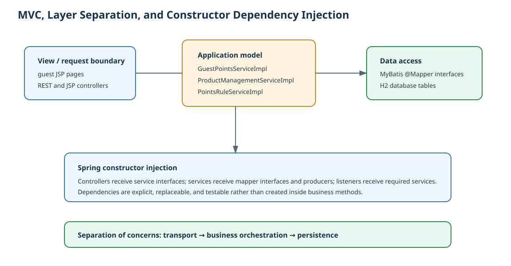

### 5.11 Repository-level design principles

The implementation applies the following principles:

- **Single Responsibility Principle:** controllers handle transport, services orchestrate
  business rules, mappers handle persistence, and payment strategies validate one payment type.
- **Open/Closed Principle:** new payment strategies and event listeners can be added without
  rewriting the redemption orchestration or existing listeners.
- **Dependency Inversion Principle:** services depend on mapper and producer interfaces or
  abstractions rather than constructing database or messaging infrastructure directly.
- **Encapsulation:** payment validation, order transitions, security checks, and persistence
  operations are kept behind focused interfaces and service boundaries.
- **Separation of concerns:** authentication, authorization, business validation, persistence,
  messaging, and presentation are placed in separate packages and layers.
- **Fail-fast validation:** invalid status, portal, payment, stock, balance, and input conditions
  are rejected before dependent operations continue.
- **Defensive security design:** role-based URL rules, ownership checks, BCrypt password hashing,
  generic login errors, and explicit account-status checks reduce unauthorized access and
  information disclosure.

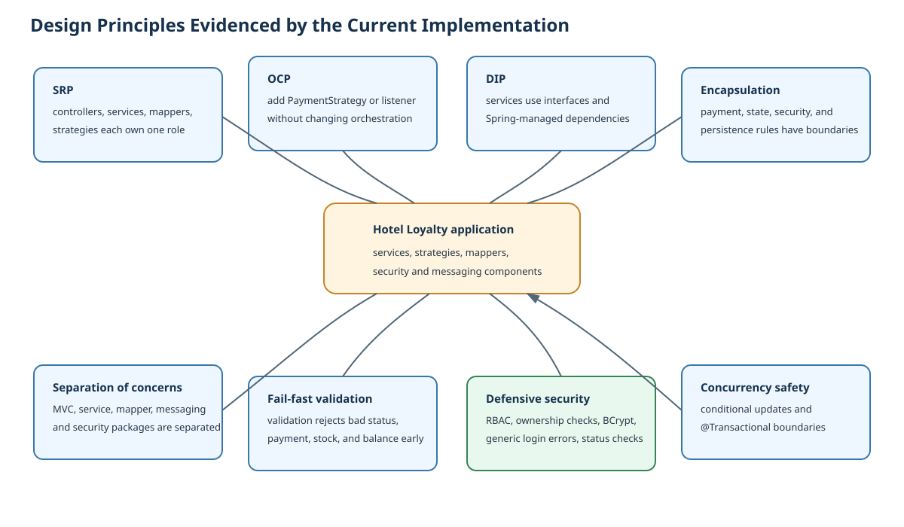

---

## 6. Domain Model

The core persistent entities are:

| Entity | Purpose |
|---|---|
| `UserDO` | Guest or manager identity, role, status, level, and point balance |
| `ProductDO` | Points-mall product and stock information |
| `PaymentMethodDO` | Configured payment method catalogue |
| `OrderDO` | A guest redemption request and its payment data |
| `PointsTransactionDO` | Signed points audit record |
| `PointsRuleDO` | Manager-maintained earning rule definition |

The current implementation stores both guest and manager accounts in `UserDO`. They are not Java subclasses. Spring Security maps the stored role to `ROLE_GUEST` or `ROLE_MANAGER`.

The principal relationships are:

```text
User 1 ---- * Order
User 1 ---- * PointsTransaction
Product 1 ---- * Order
PaymentMethod 1 ---- * Order
Order 1 ---- * PointsTransaction
PointsRule ..> User
```

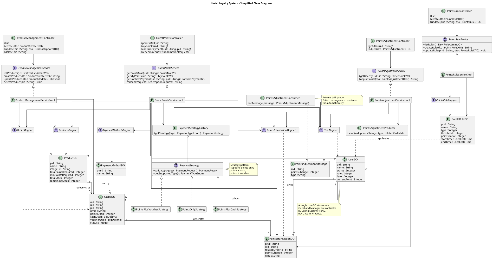

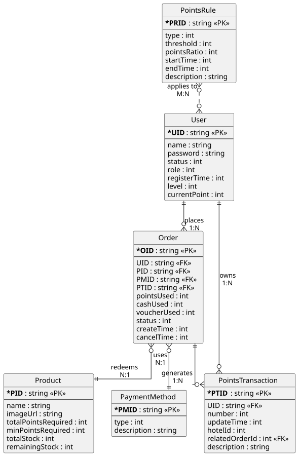

The application uses business identifiers (`uid`, `pid`, `pmid`, `oid`, `ptid`, and `prid`) in service and mapper operations. The database schema intentionally keeps foreign-key enforcement in the application layer.

---

## 7. Database Design

The database is H2 in file mode:

```text
./data/hotelloyalty
```

Schema initialization is enabled on startup. The main tables are:

```text
user
product
payment_method
order
points_transaction
points_rule
```

Important data rules:

- all tables have a generated numeric `id`;
- business identifiers have unique constraints;
- `points_change` is signed;
- `remaining_stock` is maintained separately from `total_stock`;
- `related_order_id` is nullable for non-order earnings;
- orders and points transactions keep creation and modification timestamps.

The schema is defined in [`schema.sql`](Project/hotel-loyalty/src/main/resources/schema.sql), and initial demonstration data is in [`data.sql`](Project/hotel-loyalty/src/main/resources/data.sql).

---

## 8. API and Page Endpoints

### Authentication

| Method | Endpoint | Purpose |
|---|---|---|
| GET | `/login` | Guest login page |
| GET | `/admin/login` | Manager login page |
| POST | `/auth/login` | Spring Security login processing |
| POST | `/logout` | Session logout |

### Guest pages and APIs

| Method | Endpoint | Purpose |
|---|---|---|
| GET | `/guest/{uid}/account` | Render the guest account page |
| GET | `/guest/{uid}/points-mall` | Render the guest points mall |
| GET | `/guest/{uid}/my-points` | Render balance and redemption page |
| GET | `/guest/{uid}/confirm-payment/{pid}` | Render payment confirmation |
| POST | `/guest/{uid}/redemptions` | Submit JSP redemption |
| GET | `/api/guest/{uid}/account` | Get account data |
| GET | `/api/guest/{uid}/points-mall` | Get mall data |
| GET | `/api/guest/{uid}/my-points` | Get guest points data |
| GET | `/api/guest/{uid}/confirm-payment/{pid}` | Get payment data |
| POST | `/api/guest/redemptions` | Submit REST redemption |

Guest endpoints verify that the URL or request UID matches the authenticated session identity.

### Manager pages and APIs

| Method | Endpoint | Purpose |
|---|---|---|
| GET | `/admin/products` | Product management page |
| GET | `/admin/rules` | Points-rule management page |
| GET | `/admin/points` | Manual points adjustment page |
| GET | `/api/admin/products` | List products |
| POST | `/api/admin/products` | Create product |
| GET | `/api/admin/products/{pid}` | Get product |
| PUT | `/api/admin/products/{pid}` | Update product |
| DELETE | `/api/admin/products/{pid}` | Delete product |
| GET | `/api/admin/rules` | List rules |
| POST | `/api/admin/rules` | Create rule |
| GET | `/api/admin/rules/{prid}` | Get rule |
| PUT | `/api/admin/rules/{prid}` | Update rule |
| GET | `/api/admin/points/user/{uid}` | Verify target user |
| POST | `/api/admin/points/adjustment` | Enqueue manual point adjustment |

All `/admin/**` and `/api/admin/**` routes require the manager role.

---

## 9. Security and Reliability

### Authentication and authorization

- Session-based Spring Security authentication.
- BCrypt password encoding.
- Separate guest and manager login portals.
- URL-level role-based access control.
- Guest ownership checks against `SecurityContext`.
- Explicit 30-minute session timeout.

### Data and transaction safety

- Redemption is transactional.
- Point balance updates use compare-and-update semantics.
- Stock deduction checks remaining stock in the update operation.
- Product deletion checks for active orders before deletion.
- Validation annotations are used on request DTOs.

### Asynchronous reliability

- Embedded Artemis is configured as persistent.
- Manual adjustments are queued before processing.
- Consumer exceptions trigger broker redelivery.
- Point adjustment and transaction creation are performed by the consumer.

### Current limitations

- CSRF is disabled because the current JSP JavaScript calls REST endpoints without CSRF tokens. This is acceptable for the academic prototype but should be corrected for production.
- No explicit user-facing queue status or dead-letter workflow is currently exposed.
- The adjustment reason is logged but not stored in the database.
- The points-rule table is not yet connected to an external hotel-order earning flow.

---

## 10. User Interface

The UI is server-rendered using JSP and JSTL.

| View | Purpose |
|---|---|
| `login.jsp` | Guest login |
| `admin_login.jsp` | Manager login |
| `guest_account.jsp` | Show account information |
| `guest_points_mall.jsp` | Browse products |
| `guest_confirm_payment.jsp` | Select and confirm payment |
| `guest_my_points.jsp` | Show balance and redemption records |
| `admin_products.jsp` | Product CRUD |
| `admin_points_rules.jsp` | Points rule CRUD |
| `admin_points_adjust.jsp` | Manual point award |
| `products.jsp` | Product-list demonstration page |

The currently working demonstration page is:

```text
http://localhost:8080/demo/products
```

The manager product page is:

```text
http://localhost:8080/admin/products
```

---

## 11. Demo Data and Running the Application

### Prerequisites

- JDK 21 or a compatible newer JDK
- Maven Wrapper included in the project

### Start the application

From the application directory:

```bash
cd Project/hotel-loyalty
./mvnw spring-boot:run
```

On Windows:

```bat
cd Project\hotel-loyalty
mvnw.cmd spring-boot:run
```

The default server address is:

```text
http://localhost:8080
```

### Build and test

```bash
cd Project/hotel-loyalty
./mvnw test
./mvnw package
```

The generated executable JAR is placed under `Project/hotel-loyalty/target/`.

### Demonstration credentials

The seed data defines:

| Role | Username | Password |
|---|---|---|
| Manager | `admin` | `admin123` |
| Guest | `guest` | `guest123` |

These credentials are for local demonstration only and must be replaced in a deployed environment.

### Useful local tools

- H2 Console: `http://localhost:8080/h2-console`
- OpenAPI JSON: `http://localhost:8080/v3/api-docs`
- Swagger UI: `http://localhost:8080/swagger-ui.html`

For the H2 console, use the JDBC URL configured in `application.yaml` and the local `sa` user.

---

## 12. Testing Status

The repository currently contains a Spring context smoke test:

```text
src/test/java/com/hotel/hotel_loyalty/HotelLoyaltyApplicationTests.java
```

The current automated suite contains 103 tests covering:

1. Login, account-status, guest-ownership, and manager-role security behavior.
2. Product create, update, delete, validation, and active-order protection.
3. Points-only, points-plus-cash, and points-plus-voucher validation.
4. Minimum-point, supplement-conversion, insufficient-balance, and out-of-stock redemption.
5. Atomic balance, stock, order, and points-transaction changes.
6. Voucher redemption transaction-history linkage.
7. Manual-award queue processing and optimistic-lock retry behavior.
8. Event-driven reward distribution: `PointsDeductedEvent` publication and listener stock deduction.
9. Mapper, controller, service, state, and application-context behavior.

The suite does not yet provide browser-level end-to-end coverage for every use case, real external
payment-provider tests, points-rule calculation integration, or queue dead-letter operations.

The full suite currently passes with `./mvnw clean test`.

---

## 13. UML and Supporting Documents

The repository contains the following supporting artifacts:

| Artifact | Location |
|---|---|
| Use-case catalogue | [`Use_case_1.0.xlsx`](UseCases/Use_case_1.0.xlsx) |
| Detailed UC3 and UC6 descriptions | [`Use_Case_Description_UC3_UC6_v1.1.xlsx`](UseCases/Use_Case_Description_UC3_UC6_v1.1.xlsx) |
| Original class diagram | [`class_diagram_1.0.svg`](UML/class_diagram_1.0.svg) |
| Use-case diagram | [`all_user_case.svg`](UML/all_user_case.svg) |
| Product-management sequence diagram | [`manage_products.svg`](UML/manage_products.svg) |
| Redemption sequence diagram | [`redeem_points_for_products.svg`](UML/redeem_points_for_products.svg) |
| Order state diagram | [`order_state_diagram_1.0.svg`](UML/order_state_diagram_1.0.svg) |
| Entry relationship diagram | [`entry_relationship_diagram.svg`](UML/entry_relationship_diagram.svg) |
| Layered package architecture | [`layered_architecture.svg`](UML/layered_architecture.svg) |
| Payment strategy UML | [`payment_strategy_uml.svg`](UML/payment_strategy_uml.svg) |
| Message-driven points adjustment | [`message_driven_points_adjustment.svg`](UML/message_driven_points_adjustment.svg) |
| Optimistic concurrency control | [`optimistic_concurrency.svg`](UML/optimistic_concurrency.svg) |
| Login Chain of Responsibility and Template Method | [`login_chain_template.svg`](UML/login_chain_template.svg) |
| Observer event extension point | [`observer_event.svg`](UML/observer_event.svg) |
| Factory and Data Mapper | [`factory_data_mapper.svg`](UML/factory_data_mapper.svg) |
| MVC and dependency injection | [`mvc_dependency_injection.svg`](UML/mvc_dependency_injection.svg) |
| Design principles evidence | [`design_principles.svg`](UML/design_principles.svg) |
| Database schema | [`schema.sql`](Project/hotel-loyalty/src/main/resources/schema.sql) |

The original UML assets describe the conceptual design and should be read together with the current implementation notes in this report. In particular:

- the running code uses one `UserDO` with role-based security rather than Java `Guest` and `Manager` subclasses;
- payment methods are stored as database records while payment validation is implemented through `PaymentStrategy`;
- the current guest page shows both redemption records and the full points transaction history;
- order-state classes exist, but the current redemption service directly persists the relevant status transitions.

---

## 14. Implementation Gaps and Recommended Next Steps

### Priority 1: **[Key gap]** Connect points rules to earning

Introduce an external-order earning service that selects an applicable `PointsRuleDO`, calculates the points ratio, and sends the resulting earning event through the existing adjustment/message mechanism.

### Priority 2: **[Key gap]** Add operational queue management

Persist the manual-adjustment reason, add a durable request identifier, and expose queued, processed, retrying, and permanently failed states with dead-letter administration.

### Priority 3: **[Partially complete]** Make product availability explicit

The backend filters out-of-stock products, but the guest-facing model should expose availability and stock status explicitly where the use case requires it.

### Priority 4: **[Partially complete]** Complete order lifecycle parity

Connect the existing order-state classes to cancellation, fulfilment, and shipment workflows. UC1
account viewing is complete; the remaining gap is order lifecycle behavior, not account data.

### Test coverage status

The current automated suite contains 103 tests, all passing with `./mvnw clean test`; the covered
areas are listed in section 12.

---

## 15. Conclusion

The current project is a working academic prototype of a hotel loyalty points mall. Its strongest implemented areas are the core redemption transaction, role-based manager/guest separation, product CRUD, strategy-based payment validation, and asynchronous manual point adjustment.

The principal differences between the original design documents and the current code are implementation-level rather than architectural: the application uses role-based persistence instead of user inheritance, strategy classes instead of payment-method subclasses, and service/mapper layers instead of domain objects containing all behavior.

The next meaningful increment is to expose product availability more explicitly and connect managed points rules to an actual points-earning workflow. Once those are implemented and covered by browser-level tests, the project will have much stronger traceability from the use-case catalogue through the UML artifacts to the running application.
