# Hotel Loyalty Points Mall

## Project Report

> A hotel loyalty points management and redemption system built with Spring Boot, JSP, MyBatis, H2, Spring Security, and embedded Artemis JMS.

**Project:** CS6451 Advanced Software Design  
**Application:** `hotel-loyalty`  
**Version:** `0.0.1-SNAPSHOT`  
**Java:** 21  
**Build:** Maven  
**Last reviewed:** 4 November 2026

---

## 1. Business Scenario

Hotel guests earn and spend loyalty points. The hotel publishes redeemable products in a points mall, such as benefits or hotel-related rewards. A guest can pay with points alone, or with a mix of points and another payment method (currently cash or voucher).

Managers maintain the product catalogue and the rules that describe how points are earned. They can also manually award points to a guest. Manual awards go into a queue, so temporary processing failures do not lose the request.

The main business rules are:

- A guest must be logged in and can only access their own resources.
- A manager-only operation must not be available to a guest.
- A redemption cannot use more points than the guest owns.
- A redemption cannot use an unavailable product.
- Remaining stock must never go negative.
- A product with active orders cannot be deleted.
- Every redemption and manual award creates a signed points transaction.

### Actual running screenshots

The following screenshots show the implemented application running, rather than only
the design-time HTML prototypes:

#### Points Mall


#### My Points


#### Add Product


#### Points Adjustment


---

## 2. Executive Summary

Hotel Loyalty is a web application for managing a hotel's guest loyalty points and points-mall products. It has two authenticated user roles:

- **Guest**: logs in, views the points mall, checks the current balance, picks a product, chooses a payment method, and redeems the product.
- **Manager**: logs in through the manager portal, manages points-mall products, manages points rules, and manually adds points to a guest account.

The current implementation uses server-rendered JSP pages for the user interface and REST endpoints for browser-side administration and guest operations. Business logic lives in service classes, database access is isolated in MyBatis mappers, and Spring Security controls role-based access.

The implementation also shows several software-design techniques:

1. **Layered architecture**: controller, service, mapper, and persistence layers.
2. **Strategy pattern**: payment validation is selected through `PaymentStrategyFactory`.
3. **State pattern**: order lifecycle states are represented by the classes in the `order` package.
4. **Message-driven processing**: manual point adjustments are sent to an embedded Artemis queue and processed asynchronously.
5. **Optimistic concurrency control**: point balances and stock are updated with compare-and-update operations.

### Architecture diagrams

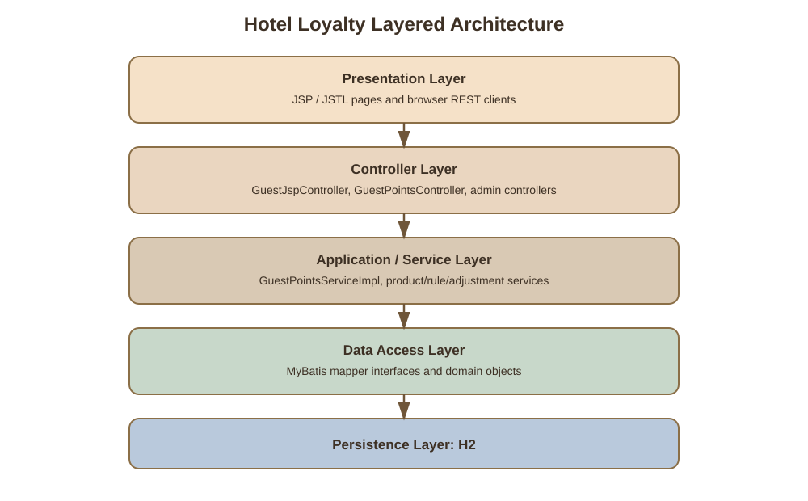

The design-time package boundaries are shown in [`package_diagram.svg`](UML/package_diagram.svg).
The runtime component collaboration is shown below.

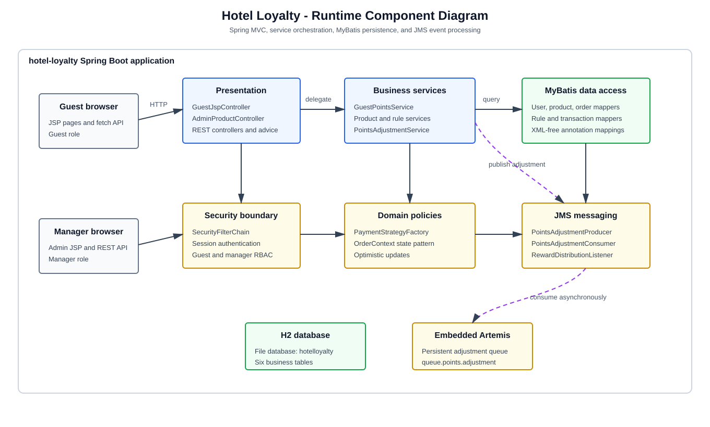

The single-host deployment topology is shown below.

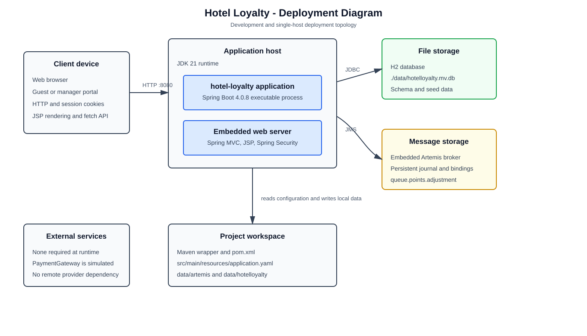

The payment design is a **Strategy pattern**, shown below.
It is not a Chain of Responsibility: `PaymentStrategyFactory` picks exactly one strategy from
`PaymentTypeEnum`, and strategies do not pass an unhandled request to one another. The controller and
service call the chosen strategy directly.

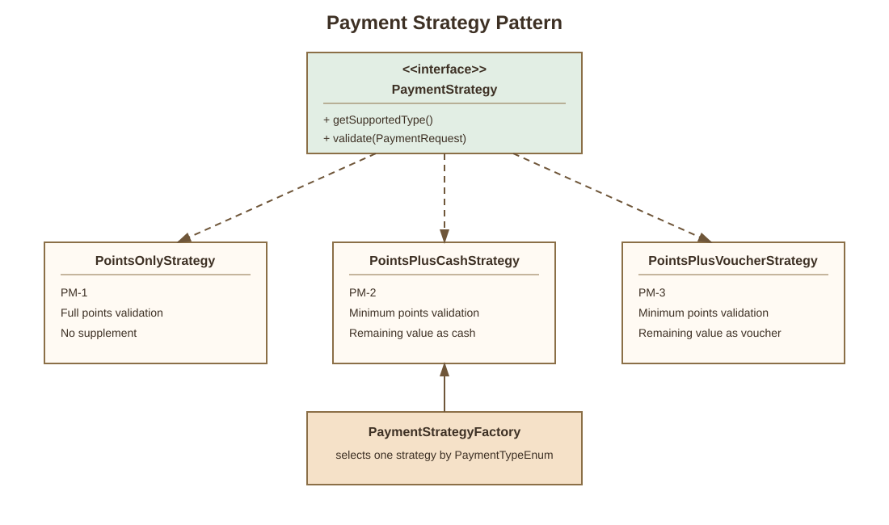

The asynchronous points-adjustment flow and its reliability controls are shown below. The manager request
is validated and placed on the persistent `queue.points.adjustment` Artemis queue. The listener updates
the user balance and writes the transaction. An exception rolls back processing and causes redelivery;
the optimistic compare-and-update also turns concurrent balance conflicts into retryable failures.

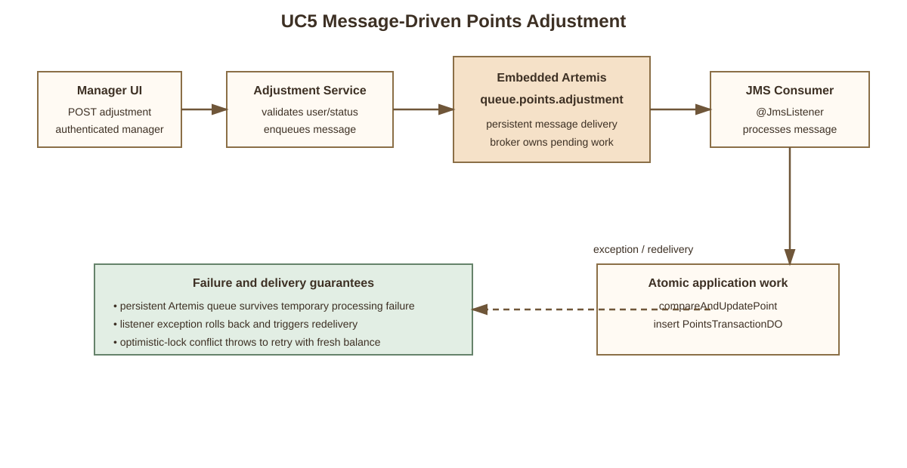

This report describes the implemented system, not the original conceptual model. Where a use case or UML artifact describes planned behavior that is not yet connected to the running code, it is explicitly marked as a gap.

---

## 3. Scope and Use Cases

The use-case catalogue has six primary use cases.

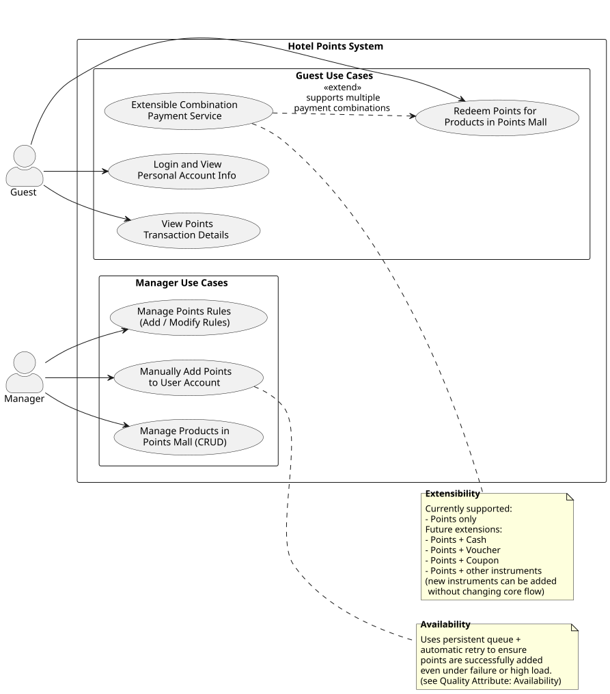

| ID | Use case | Current implementation |
|---|---|---|
| UC1 | Guest login and personal account information | **[Implemented]** Login, session identity, user ID, name, role, status, level, balance, registration time, and account page are implemented |
| UC2 | View points transaction details | **[Implemented]** My Points shows signed history, type, related order, timestamp, and redemption orders |
| UC3 | Redeem points for products in the points mall | **[Implemented within simulated-payment scope]** Points, simulated cash, and simulated voucher flows validate and persist orders |
| UC4 | Manager manages points rules | **[Partially implemented / key gap]** Rule CRUD works; **hotel-order points calculation and award processing are not connected** |
| UC5 | Manager manually adds points | **[Core implemented / partially complete]** Persistent queue, consumer, retry, balance update, and EARN transaction work; **queue status, dead-letter handling, request status, and reason persistence are not implemented** |
| UC6 | Manager manages products | **[Core implemented / partially complete]** Product CRUD and validation work; **guest-facing inventory availability needs better presentation** |

### Implementation status at a glance

These are the **key incomplete or not-yet-implemented features** and should not be described as fully delivered:

- **UC1:** No known missing item within the current use-case scope. The account page shows every field currently stored for the user: ID, name, role, status, level, current points, and registration time.
- **UC3:** No missing item within the agreed prototype scope. Cash and voucher are intentionally simulated; real provider integration is explicitly out of scope.
- **UC4 — Rule execution:** managers can maintain rules, but no hotel-order earning event picks a rule and calculates/awards points.
- **UC5 — Operational queue management:** there is no user-facing queued/processed/retrying/failed status, durable request ID, dead-letter administration, or persisted adjustment reason.
- **UC6 — Availability presentation:** the backend filters available products, but the guest-facing product view does not show a complete stock/availability state for every product.
- **Order lifecycle orchestration:** the redemption service uses the order state classes for the pay transition, but cancellation, fulfilment, and shipment workflows are not implemented.

### UC1 - Login and account information

The application has separate login pages:

- `/login` for guests
- `/admin/login` for managers

Authentication uses Spring Security sessions and BCrypt passwords. The guest points page shows the guest name, level, balance, registration time, and redemption records. The account page shows all stored account fields: user ID, name, role, status, membership level, current points, and registration time. **UC1 is complete for the current data model and viewing scope.**

### UC2 - Points transaction details

The database and mapper support transaction history through `PointsTransactionMapper.selectByUid`. Redemption and manual-award flows also create `PointsTransactionDO` records. `MyPointsVO` and `guest_my_points.jsp` show the complete signed transaction history in the Points History tab:

- transaction date;
- positive or negative points change;
- transaction type (`EARN` or `REDEEM`);
- related order ID, when applicable.

### UC3 - Redeem products

The guest redemption flow is implemented by `GuestPointsServiceImpl`:

1. Load and validate the guest and product (including an in-stock pre-check).
2. Validate the chosen payment strategy.
3. Create a pending order.
4. Atomically deduct points with an optimistic balance check (compare-and-update).
5. Settle the non-points portion through `PaymentGateway` (simulated cash charge or voucher redemption).
6. Mark the order as paid through the `OrderContext` state pattern with a compare-and-update status transition.
7. Insert a negative points transaction linked to the order.
8. Publish a `PointsDeductedEvent`; `RewardDistributionListener` runs synchronously within
   the same transaction and deducts one unit of product stock as the reward-distribution step.

The My Redemptions tab reads the same paid order records through `OrderMapper.selectByUid`, so
points-only, cash, and voucher redemptions all appear after successful completion.

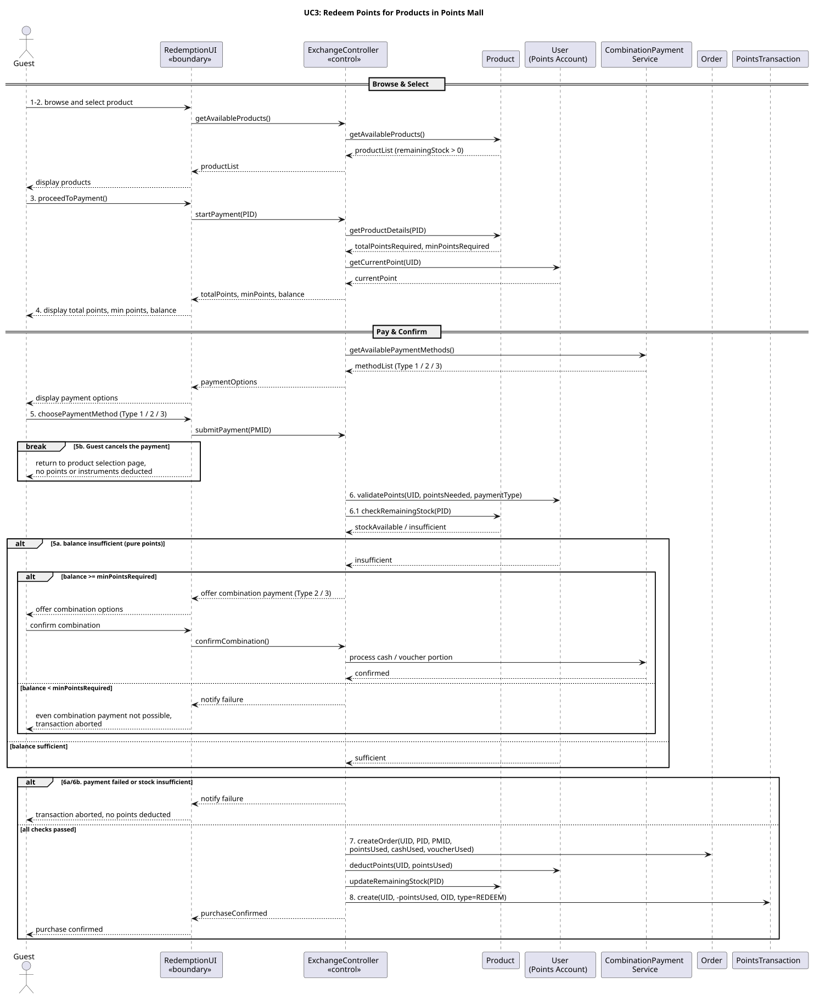

The supported payment strategies are:

- points only;
- points plus cash;
- points plus voucher.

The cash and voucher interactions are intentionally simulated for this academic prototype.
Real external payment authorization, capture, refund, timeout reconciliation, and provider-failure
handling are **out of scope**, not incomplete implementation work.

### UC4 - Manage points rules

Managers can list, create, and update rules. The service validates rule type and the time range for period rules. Level rules clear the threshold because they do not use a minimum external order amount.

The rule data is stored and managed, but no external hotel-order earning process in this application reads the rules to calculate newly earned points. The management part of UC4 is therefore implemented; **the following calculation and award integration is not implemented**.

### UC5 - Manually add points

Managers verify a target user, enter a positive point amount, and may optionally provide a reason. The request is sent to the persistent Artemis queue. `PointsAdjustmentConsumer` updates the balance and creates an `EARN` transaction. Exceptions cause message redelivery, which gives automatic retry behavior.

The optional reason is currently written to the application log, not persisted in `points_transaction`, whose schema has no reason column. **There is also no queue-status API, durable request ID, dead-letter administration, or user-facing retry status.**

### UC6 - Manage products

Managers can:

- create a product;
- list products;
- get product details;
- update product information and stock;
- delete a product when it has no active orders.

On creation, `remainingStock` is set to `totalStock`. The service validates that minimum points do not exceed total points and that remaining stock does not exceed total stock. **The guest-facing catalogue currently filters unavailable products instead of showing a complete availability status.**

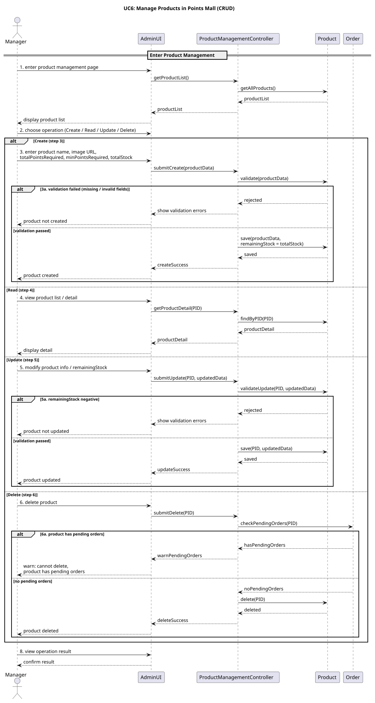

### Required detailed use-case descriptions

The following two key use cases are the detailed use cases selected for the report. They
follow the lecture-note template and are consistent with the implementation status above.

#### Key use case UC3 - Redeem points for a product

| Field | Description |
|---|---|
| Primary actor | Guest |
| Supporting actors/systems | Spring Security, payment strategy, H2 database, synchronous reward listener |
| Goal | Exchange points, or points plus a simulated cash/voucher payment, for an available product |
| Trigger | An authenticated guest submits the redemption form or REST request |
| Preconditions | The guest is authenticated and owns the session; the product exists; the product is available; the request passes validation |
| Main success scenario | 1. Load the guest, product, and payment method. 2. Validate the selected payment strategy. 3. Create a pending order. 4. Atomically deduct points. 5. Process the simulated non-points payment when applicable. 6. Transition the order to paid. 7. Insert the signed redemption transaction. 8. Publish `PointsDeductedEvent` and deduct one unit of stock. |
| Alternative and exception flows | Insufficient points, invalid payment details, missing product, unavailable stock, failed optimistic update, or payment failure abort the transaction and do not leave a partial redemption. |
| Postconditions | A successful redemption has a paid order, a negative points transaction linked to that order, and one fewer unit of remaining stock. A failed redemption leaves the protected balance, stock, and order data unchanged. |
| Quality attributes | Extensibility through `PaymentStrategy`; reliability through transactions and conditional updates; security through ownership and role checks. |

#### Key use case UC6 - Manage products

| Field | Description |
|---|---|
| Primary actor | Manager |
| Supporting actors/systems | Spring Security, `ProductManagementService`, `ProductMapper`, H2 database |
| Goal | Create, inspect, update, and delete points-mall products while preserving stock and order constraints |
| Trigger | An authenticated manager submits a product-management operation |
| Preconditions | The manager is authenticated with `ROLE_MANAGER`; create/update data passes DTO validation; the target product exists for read/update/delete operations |
| Main success scenario | 1. Manager opens the product-management page. 2. The controller validates the request. 3. The service checks point and stock invariants. 4. The mapper persists the create/update/delete operation. 5. The updated product list or result is returned. |
| Alternative and exception flows | Invalid points or stock values are rejected; an unknown product returns an error; deletion is rejected when active orders reference the product. |
| Postconditions | A successful create or update stores a product with valid point and stock values; a successful delete removes only a product with no active orders. |
| Quality attributes | Security through manager-only routes; modifiability through controller/service/mapper separation; auditability through persisted product and order records. |

---

## 4. Functional Architecture

The application follows a layered web architecture:

```text
JSP pages / REST clients
          |
          v
Controllers
          |
          v
Application services
          |
          v
MyBatis mappers
          |
          v
H2 database
```

The asynchronous manual-award path is:

```text
Manager UI
    |
    v
PointsAdjustmentController
    |
    v
PointsAdjustmentService
    |
    v
Artemis queue
    |
    v
PointsAdjustmentConsumer
    |
    +--> UserMapper
    |
    +--> PointsTransactionMapper
```


### Architectural patterns

- **MVC + REST:** controllers receive HTTP requests and return JSON or forward to JSP
  views; DTOs, VOs, and DOs carry model data; services hold business logic; the web
  layer does not access the database directly.
- **Layered architecture (independently researched):** the request path is Controller
  → Service → MyBatis Mapper → H2. Domain objects are shared data objects, not an
  additional call-chain step. This pattern was selected from independent architecture
  research rather than from the lecture list of MVC, Broker, and Scheduler.
- **Event-driven architecture:** points-adjustment requests are placed on a persistent
  Artemis queue and processed later by a consumer. The producer and consumer share only
  the queue contract, allowing retry on processing conflicts and keeping the caller
  independent from the work.

### Architectural pattern code evidence

The three architectural patterns above are evidenced by the following source excerpts.

**MVC + REST — the controller is a thin transport layer that delegates to the service**
(`GuestPointsController.java`):

```java
@RestController
@RequestMapping("/api/guest")
@Validated
public class GuestPointsController {

    private final GuestPointsService guestPointsService;

    public GuestPointsController(GuestPointsService guestPointsService) {
        this.guestPointsService = guestPointsService;
    }

    /** IDOR defense: the uid in the request must match the session identity. */
    private void checkOwnership(String requestUid) {
        String sessionUid = SecurityContextHolder.getContext()
                .getAuthentication().getName();
        if (!requestUid.equals(sessionUid)) {
            throw new AccessDeniedException("Not your resource");
        }
    }

    @PostMapping("/redemptions")
    public Result<String> redeem(@Valid @RequestBody RedemptionRequest request) {
        checkOwnership(request.getUid());
        return Result.success(guestPointsService.redeem(request));
    }
}
```

**Layered architecture — the service orchestrates business rules and delegates persistence
to mappers** (`GuestPointsServiceImpl.java`, `redeem` excerpt):

```java
@Service
public class GuestPointsServiceImpl implements GuestPointsService {

    private final UserMapper userMapper;
    private final ProductMapper productMapper;
    private final PaymentStrategyFactory paymentStrategyFactory;
    // ... further mapper and gateway dependencies

    @Transactional
    @Override
    public String redeem(RedemptionRequest request) {
        UserDO user = findUser(request.getUid());                 // mapper call
        ProductDO product = findProduct(request.getPid());        // mapper call
        PaymentTypeEnum paymentType = PaymentTypeEnum.fromPmid(request.getPmid());
        PaymentStrategy strategy =
                paymentStrategyFactory.getStrategy(paymentType);  // strategy call
        PaymentRequest paymentRequest = new PaymentRequest(request.getUid(),
                request.getPid(), request.getPmid(), request.getPointsUsed(),
                request.getCashUsed(), request.getVoucherUsed(),
                product.getTotalPointsRequired(), product.getMinPointsRequired(),
                user.getCurrentPoint());
        PaymentResult validation = strategy.validate(paymentRequest);
        if (!validation.isSuccess()) {
            throw new IllegalArgumentException(validation.getMessage());
        }
        // ... order insert, CAS point deduction, gateway settlement
    }
}
```

**Event-driven architecture — the producer enqueues and returns; the consumer processes later**
(`PointsAdjustmentProducer.java` and `PointsAdjustmentConsumer.java`):

```java
@Component
public class PointsAdjustmentProducer {

    public static final String QUEUE = "queue.points.adjustment";

    private final JmsTemplate jmsTemplate;

    public void send(String uid, Integer pointsChange, String type, String relatedOrderId) {
        PointsAdjustmentMessage message =
                new PointsAdjustmentMessage(uid, pointsChange, type, relatedOrderId);
        jmsTemplate.convertAndSend(QUEUE, message);   // enqueue and return right away
    }
}

@Component
public class PointsAdjustmentConsumer {

    private final UserMapper userMapper;
    private final PointsTransactionMapper transactionMapper;

    @JmsListener(destination = PointsAdjustmentProducer.QUEUE)
    public void onMessage(PointsAdjustmentMessage message) {
        UserDO user = userMapper.selectByUid(message.getUid());
        int newPoint = user.getCurrentPoint() + message.getPointsChange();
        if (newPoint < 0) {
            throw new IllegalStateException("points would go negative");
        }
        // Optimistic-lock update; conflict forces redelivery for automatic retry
        int updated = userMapper.compareAndUpdatePoint(
                message.getUid(), user.getCurrentPoint(), newPoint, LocalDateTime.now());
        if (updated == 0) {
            throw new IllegalStateException("optimistic lock conflict");
        }
        PointsTransactionDO txn = new PointsTransactionDO();
        txn.setUid(message.getUid());
        txn.setPointsChange(message.getPointsChange());
        txn.setType(message.getType());               // "EARN" or "REDEEM"
        transactionMapper.insert(txn);                // signed points transaction
    }
}
```

### Technology deployment pipeline

The system is intentionally **monolithic**: one Spring Boot application is built and
packaged as one executable JAR. The runtime pipeline is:

```text
Browser
  -> embedded Tomcat web/application server
  -> Spring MVC JSP controllers and REST controllers
  -> service layer
  -> MyBatis Data Mapper
  -> H2 relational EIS/database

Manager adjustment request
  -> Spring service
  -> embedded Artemis JMS message bus
  -> adjustment consumer
  -> service layer and H2 database
```

Maven and GitHub Actions form the delivery pipeline: a push runs compilation and tests,
and a tag packages the executable JAR and creates a GitHub Release. The current academic
project stops at packaging because no deployment server is configured. A production
version would replace the embedded server/database/broker with managed equivalents while
retaining the same application boundaries.

### Main packages

| Package | Responsibility |
|---|---|
| `controller` | REST endpoints and JSP page controllers |
| `service` | Application service interfaces |
| `service.impl` | Business rules and transaction orchestration |
| `domain` | Persistence/domain objects |
| `dto` | Validated request payloads |
| `vo` | View and API response objects |
| `mapper` | MyBatis data-access interfaces |
| `payment` | Payment strategy abstractions and implementations |
| `messaging` | Artemis producer, consumer, messages, and events |
| `order` | Order state abstraction |
| `security` | Authentication, login flow, and role handling |
| `config` | Spring Security and JMS configuration |

---

## 5. Design Patterns

### 5.1 Layered architecture

Controllers do not directly implement persistence logic. For example:

```text
ProductManagementController
        -> ProductManagementService
        -> ProductMapper
        -> ProductDO
```

This keeps HTTP concerns separate from business validation and database access.


### 5.2 Strategy pattern for payment

`PaymentStrategy` defines the validation contract. The concrete strategies are:

- `PointsOnlyStrategy`
- `PointsPlusCashStrategy`
- `PointsPlusVoucherStrategy`

`PaymentStrategyFactory` picks a strategy by `PaymentTypeEnum`. A new payment instrument can therefore be added as another strategy without changing the main redemption orchestration.

The class relationship and concrete implementations are shown above. This is not a Chain of Responsibility:
there is no sequential handler chain, fallback handler, or `next` reference.

```java
// PaymentStrategy.java — one rule set per payment type (no if-else block in the service):
public interface PaymentStrategy {
    PaymentTypeEnum getSupportedType();
    PaymentResult validate(PaymentRequest request);
}

// PointsOnlyStrategy.java — Type 1: pure points payment,
// points must cover the full price:
@Component
public class PointsOnlyStrategy implements PaymentStrategy {

    @Override
    public PaymentTypeEnum getSupportedType() {
        return PaymentTypeEnum.POINTS_ONLY;
    }

    @Override
    public PaymentResult validate(PaymentRequest request) {
        if (request.getCashUsed() != null || request.getVoucherUsed() != null) {
            return PaymentResult.fail("points-only payment must not include cash or voucher");
        }
        if (request.getPointsUsed() == null
                || !request.getPointsUsed().equals(request.getProductTotalPoints())) {
            return PaymentResult.fail("points must equal the full product price");
        }
        if (request.getPointsUsed() > request.getUserCurrentPoint()) {
            return PaymentResult.fail("insufficient points");
        }
        return PaymentResult.ok();
    }
}
```

Adding a new payment type means adding a new class and one enum value in `PaymentTypeEnum` — the service and the other strategies do not change (Open/Closed Principle).


### 5.3 State pattern for orders

The `order` package contains:

- `OrderState`
- `PendingPaymentState`
- `PaidState`
- `CompletedState`
- `CancelledState`
- `OrderContext`

The current guest redemption service uses `OrderContext` to validate the pay transition, then persists the new status with a compare-and-update. The state classes provide the model for order lifecycle behavior and can be expanded as cancellation and fulfilment workflows are added.

```java
// OrderContext.java — rebuild the state machine from a persisted status code:
public static OrderContext fromDbStatus(String oid, Integer statusDb) {
    OrderStatusEnum status = OrderStatusEnum.fromCode(statusDb);
    if (status == null) {
        throw new IllegalArgumentException("unknown order status code: " + statusDb);
    }
    switch (status) {
        case PENDING_PAYMENT: return new OrderContext(oid, PendingPaymentState.INSTANCE);
        case PAID:            return new OrderContext(oid, PaidState.INSTANCE);
        case COMPLETED:       return new OrderContext(oid, CompletedState.INSTANCE);
        case CANCELLED:       return new OrderContext(oid, CancelledState.INSTANCE);
        default: throw new IllegalArgumentException("unknown order status code: " + statusDb);
    }
}

// PendingPaymentState.java — initial state; pay() moves to Paid,
// illegal transitions throw:
public class PendingPaymentState implements OrderState {

    public static final PendingPaymentState INSTANCE = new PendingPaymentState();

    @Override
    public void pay(OrderContext context) {
        context.setState(PaidState.INSTANCE);          // legal transition
    }

    @Override
    public void complete(OrderContext context) {
        throw new IllegalStateException("cannot complete an unpaid order");
    }
}
```

The service then persists the transition with a conditional update
(`GuestPointsServiceImpl.java`):

```java
OrderContext orderCtx = OrderContext.fromDbStatus(oid, order.getStatus());
orderCtx.pay();   // in-memory rule check — first line of defense
orderMapper.compareAndUpdateStatus(oid,
        OrderStatusEnum.PENDING_PAYMENT.getCode(),
        orderCtx.getCurrentState().getStatus().getCode(), now);
```

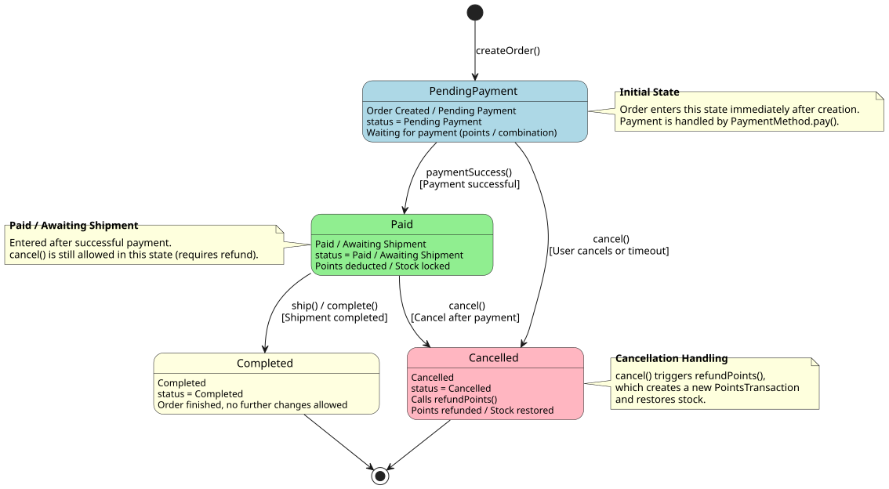

### 5.4 Message-driven processing

Manual point awards are decoupled from the manager request through Artemis JMS. The producer acknowledges the request by enqueueing it, while the consumer performs the balance update and transaction insert. An exception lets the broker redeliver the message.

The queue, producer, consumer, database writes, and retry path are shown above. Persistent delivery,
listener rollback/redelivery, and optimistic locking provide the implementation's reliability mechanism;
there is no claim of exactly-once processing beyond the current transaction and message configuration.


### 5.5 Optimistic concurrency

Point and stock updates use conditional database updates. A redemption fails if the stored balance or stock changed between the initial read and the update. This stops two concurrent requests from spending the same points or stock unit.

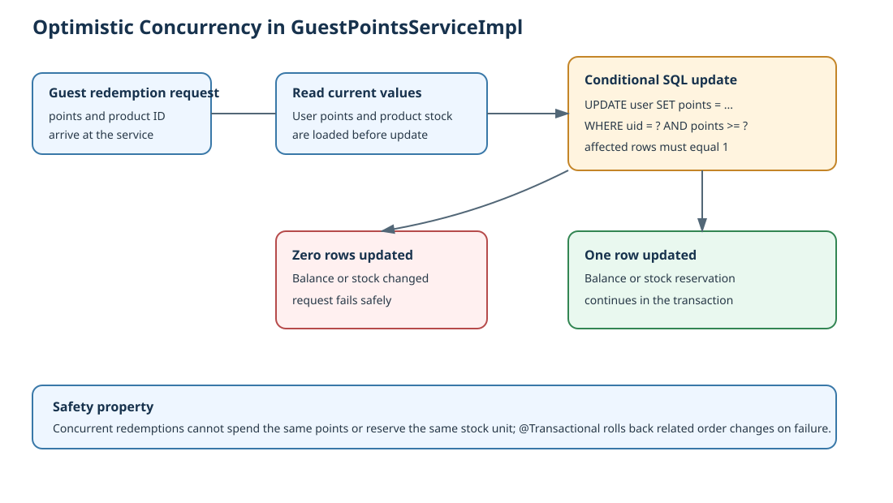

### 5.6 Chain of Responsibility for post-login checks

The security package contains a hand-written Chain of Responsibility for business checks that
run after Spring Security has authenticated the password:

```text
StatusCheckHandler
        -> PortalMatchHandler
        -> LoginLogHandler
        -> RedirectHandler
```

Each `LoginPostHandler` performs one check and passes the shared `LoginContext` to its successor.
Returning `false` stops the chain. This is separate from Spring Security's framework
`SecurityFilterChain`; the project-owned chain handles application-specific status, portal,
logging, and redirect decisions.

```java
// LoginPostHandler.java — fluent API so the chain can be assembled in one line:
public LoginPostHandler linkWith(LoginPostHandler next) {
    this.next = next;
    return next;
}

// LoginSuccessHandler.java — assembles the chain: Status -> Portal -> Log -> Redirect.
// Order matters: reject checks (status, portal) come first (fail fast).
private LoginPostHandler buildChain() {
    StatusCheckHandler head = new StatusCheckHandler();
    head.linkWith(new PortalMatchHandler())
        .linkWith(new LoginLogHandler())
        .linkWith(new RedirectHandler());
    return head;
}

// StatusCheckHandler.java — each concrete handler implements ONE check;
// returning false stops the chain.
public class StatusCheckHandler extends LoginPostHandler {
    @Override
    protected boolean doHandle(LoginContext ctx) {
        if (ctx.getStatus() != 0) {           // only NORMAL (0) may log in
            ctx.setErrorMessage("Account is not active");
            return false;                     // chain stops here
        }
        return true;
    }
}
```

Note that this is a validation chain: every handler must pass, so the chain stops at the
first failure. The reject checks (status, portal) come first, so the team only logs and
redirects users who passed the business rules.

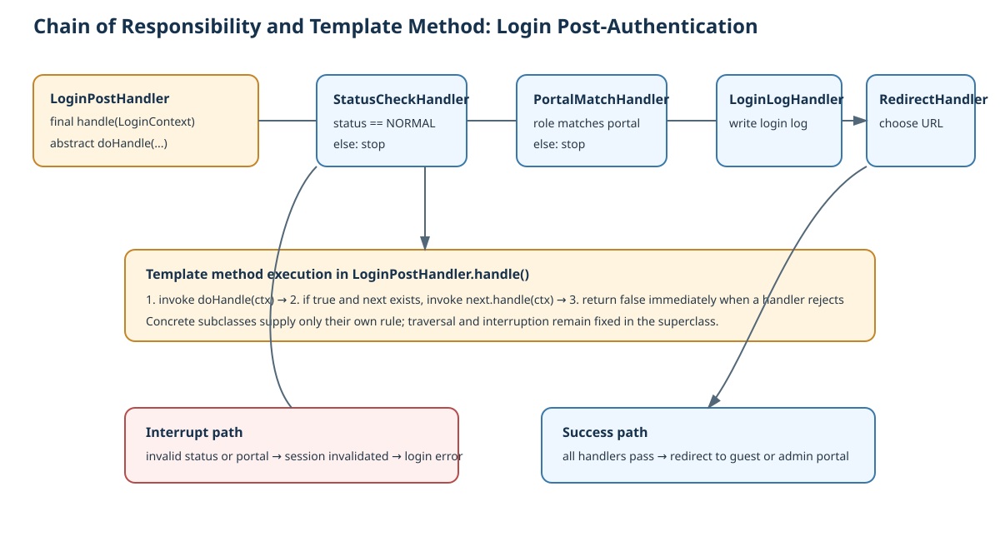

### 5.7 Template Method in login handlers

`LoginPostHandler.handle()` is a final template method. It runs the common control flow
(run the current handler, then call the successor when the check passes), while concrete
handlers implement the variable `doHandle()` step. This keeps chain traversal consistent and
limits each handler to one business rule.

```java
// LoginPostHandler.java — template method; final, so subclasses cannot override the flow:
public final boolean handle(LoginContext ctx) {
    boolean pass = doHandle(ctx);          // the one varying step
    if (pass && next != null) {
        return next.handle(ctx);           // "pass to next" is locked in the base class
    }
    return pass;
}

/** Each concrete handler implements its single check here. */
protected abstract boolean doHandle(LoginContext ctx);
```

Even though there is only one varying step, the `final` method matters: it locks the
"pass to next" flow, so no handler can bypass it or forget to call the next handler.
The chain logic stays in one place, and all four handlers stay simple.

### 5.8 Observer / publish-subscribe event handling

`RewardDistributionListener` and `PointsDeductedEvent` provide an application-level
Observer / publish-subscribe extension point. The redemption flow deducts points, settles
payment, and creates the order; the listener then deducts one unit of product stock as the
reward-distribution step. Spring's `@EventListener` runs synchronously inside the publisher's
transaction, so the stock deduction participates in the same redemption transaction and
atomicity is preserved while reward logic stays decoupled from the point-deduction service.
Additional listeners, such as notification or voucher issuance, can subscribe to the same
event without changing the existing redemption code.

```java
// GuestPointsServiceImpl.java — inside the @Transactional redeem method,
// after points are deducted:
eventPublisher.publishEvent(
        new PointsDeductedEvent(oid, request.getUid(), request.getPid(), request.getPointsUsed()));

// RewardDistributionListener.java — runs synchronously inside the
// publisher's transaction:
@Component
public class RewardDistributionListener {

    private final ProductMapper productMapper;

    @EventListener
    public void onPointsDeducted(PointsDeductedEvent event) {
        // Conditional UPDATE is the concurrency guard; zero affected rows
        // means the product sold out concurrently, so fail the transaction.
        if (productMapper.deductStock(event.getPid(), 1, LocalDateTime.now()) != 1) {
            throw new IllegalStateException(
                    "product is no longer in stock: " + event.getPid());
        }
    }
}
```

The publisher does not know about the listener — new subscribers plug in without touching
the redemption service.

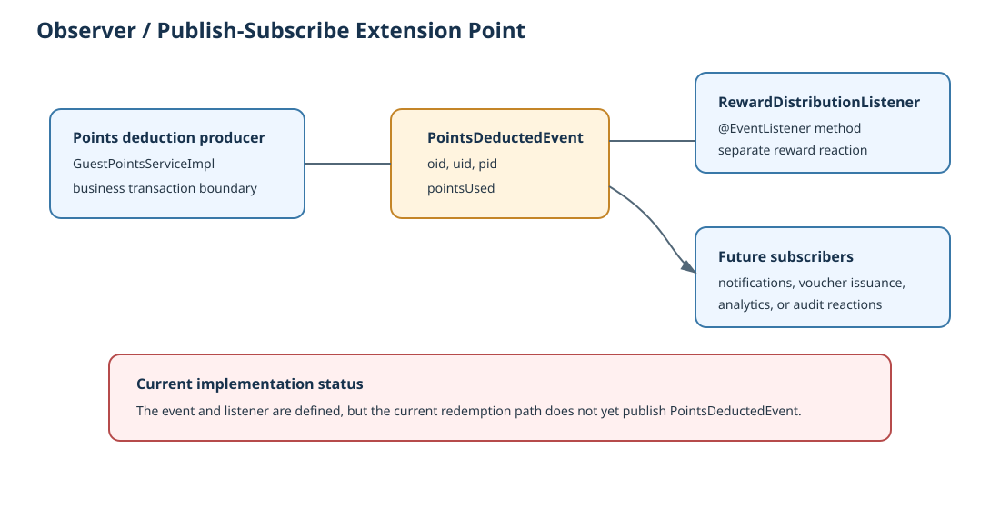

### 5.9 Factory and Data Mapper patterns

`PaymentStrategyFactory` is a Factory object that resolves a payment strategy from
`PaymentTypeEnum`. The MyBatis mapper interfaces (`UserMapper`, `ProductMapper`,
`OrderMapper`, and others) implement the Data Mapper pattern: persistence operations are
kept outside the domain objects and services.

```java
// PaymentStrategyFactory.java — Spring injects every strategy bean;
// the factory indexes them by type:
@Component
public class PaymentStrategyFactory {

    private final Map<PaymentTypeEnum, PaymentStrategy> strategyMap =
            new EnumMap<>(PaymentTypeEnum.class);

    /** Spring injects every strategy bean; the factory indexes them by type. */
    public PaymentStrategyFactory(List<PaymentStrategy> strategies) {
        for (PaymentStrategy strategy : strategies) {
            strategyMap.put(strategy.getSupportedType(), strategy);
        }
    }

    /** Adding a new payment type = add one bean, nothing else changes here. */
    public PaymentStrategy getStrategy(PaymentTypeEnum type) {
        PaymentStrategy strategy = strategyMap.get(type);
        if (strategy == null) {
            throw new IllegalArgumentException(
                    "no payment strategy registered for type: " + type);
        }
        return strategy;
    }
}
```

The Data Mapper side is plain MyBatis: mapper interfaces such as `UserMapper` hold the SQL
annotations while domain objects (`UserDO`, `ProductDO`) carry only data — persistence stays
outside the domain objects.

```java
// UserMapper.java — Data Mapper: SQL lives in the mapper interface,
// domain objects carry only data:
@Mapper
public interface UserMapper {
    // Note: no SELECT * (Alibaba rule), all parameters use #{} (never ${}).
    @Select("SELECT id, uid, name, password, status, role, register_time, "
          + "level, current_point, gmt_create, gmt_modified "
          + "FROM \"user\" WHERE uid = #{uid}")
    UserDO selectByUid(@Param("uid") String uid);

    /** Optimistic-lock point update — conditional UPDATE is the concurrency guard. */
    @Update("UPDATE \"user\" SET current_point = #{newPoint}, gmt_modified = #{gmtModified} "
          + "WHERE uid = #{uid} AND current_point = #{expectedOldPoint}")
    int compareAndUpdatePoint(@Param("uid") String uid,
                              @Param("expectedOldPoint") Integer expectedOldPoint,
                              @Param("newPoint") Integer newPoint,
                              @Param("gmtModified") LocalDateTime gmtModified);
}
```

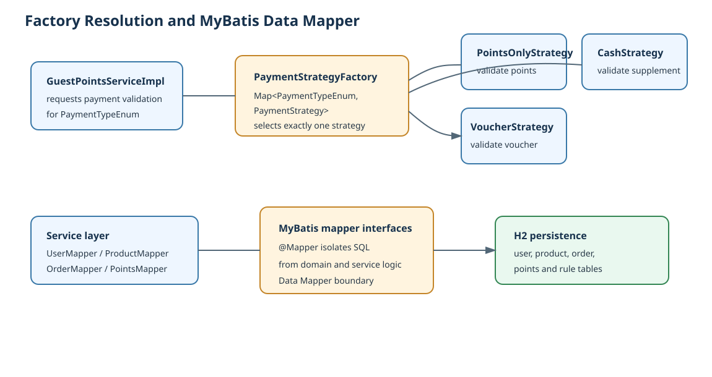

### 5.10 MVC and dependency injection

The JSP controllers and REST controllers provide the Model-View-Controller separation:
controllers handle requests, services provide application behavior, and JSP pages or
`Result` objects provide the view/response. Constructor injection is used throughout the
controllers, services, producers, consumers, and listeners, making dependencies explicit
and testable.

```java
// GuestPointsServiceImpl.java — all eight dependencies are constructor-injected;
// no field injection anywhere in the project:
@Service
public class GuestPointsServiceImpl implements GuestPointsService {

    private final UserMapper userMapper;
    private final ProductMapper productMapper;
    private final PaymentMethodMapper paymentMethodMapper;
    private final OrderMapper orderMapper;
    private final PointsTransactionMapper pointsTransactionMapper;
    private final PaymentStrategyFactory paymentStrategyFactory;
    private final PaymentGateway paymentGateway;
    private final ApplicationEventPublisher eventPublisher;

    public GuestPointsServiceImpl(UserMapper userMapper, ProductMapper productMapper,
                                   PaymentMethodMapper paymentMethodMapper, OrderMapper orderMapper,
                                   PointsTransactionMapper pointsTransactionMapper,
                                   PaymentStrategyFactory paymentStrategyFactory,
                                   PaymentGateway paymentGateway,
                                   ApplicationEventPublisher eventPublisher) {
        this.userMapper = userMapper;
        this.productMapper = productMapper;
        this.paymentMethodMapper = paymentMethodMapper;
        this.orderMapper = orderMapper;
        this.pointsTransactionMapper = pointsTransactionMapper;
        this.paymentStrategyFactory = paymentStrategyFactory;
        this.paymentGateway = paymentGateway;
        this.eventPublisher = eventPublisher;
    }
}
```

Explicit constructor injection makes the dependency surface visible in the class signature
and lets unit tests supply mocks directly, as in `GuestPointsServiceImplTest`.

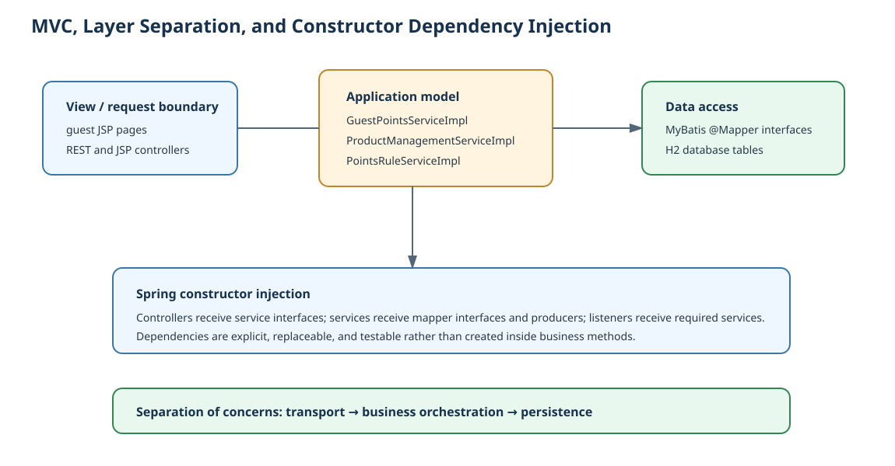

### 5.11 Repository-level design principles

The implementation applies these principles:

- **Single Responsibility Principle:** controllers handle transport, services orchestrate
  business rules, mappers handle persistence, and payment strategies validate one payment type.
- **Open/Closed Principle:** new payment strategies and event listeners can be added without
  rewriting the redemption orchestration or existing listeners.
- **Dependency Inversion Principle:** services depend on mapper and producer interfaces or
  abstractions rather than constructing database or messaging infrastructure directly.
- **Encapsulation:** payment validation, order transitions, security checks, and persistence
  operations are kept behind focused interfaces and service boundaries.
- **Separation of concerns:** authentication, authorization, business validation, persistence,
  messaging, and presentation are placed in separate packages and layers.
- **Fail-fast validation:** invalid status, portal, payment, stock, balance, and input conditions
  are rejected before dependent operations continue.
- **Defensive security design:** role-based URL rules, ownership checks, BCrypt password hashing,
  generic login errors, and explicit account-status checks reduce unauthorized access and
  information disclosure.

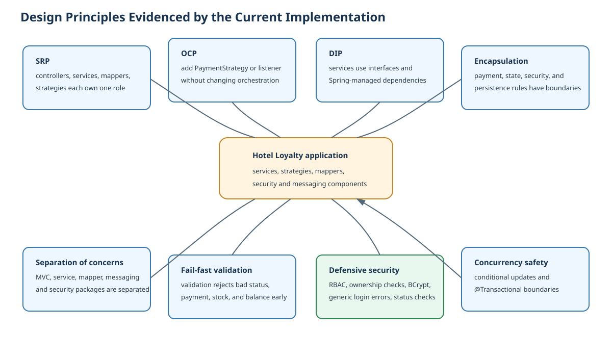

---

## 6. Domain Model

The core persistent entities are:

| Entity | Purpose |
|---|---|
| `UserDO` | Guest or manager identity, role, status, level, and point balance |
| `ProductDO` | Points-mall product and stock information |
| `PaymentMethodDO` | Configured payment method catalogue |
| `OrderDO` | A guest redemption request and its payment data |
| `PointsTransactionDO` | Signed points audit record |
| `PointsRuleDO` | Manager-maintained earning rule definition |

The current implementation stores both guest and manager accounts in `UserDO`. They are not Java subclasses. Spring Security maps the stored role to `ROLE_GUEST` or `ROLE_MANAGER`.

The main relationships are:

```text
User 1 ---- * Order
User 1 ---- * PointsTransaction
Product 1 ---- * Order
PaymentMethod 1 ---- * Order
Order 1 ---- * PointsTransaction
PointsRule ..> User
```

### Conceptual/initial design sketches

The analysis-stage design evidence is kept separate from the implementation description:

- **Candidate objects:** [`candidate_objects_1.0.xlsx`](Document/candidate_objects_1.0.xlsx)
  identifies candidate actors, entities, boundary objects, control objects, and supporting
  objects before implementation.
- **Class sketch:** [`class_diagram_1.0.svg`](UML/class_diagram_1.0.svg) shows the principal
  classes, interfaces, visibility, inheritance, aggregation/composition, associations, and
  dependencies. The final implementation uses role-based `UserDO` rather than separate
  `Guest` and `Manager` subclasses; this is documented as an implementation difference.
- **Interaction sketches:** [`redeem_points_for_products.svg`](UML/redeem_points_for_products.svg)
  and [`manage_products.svg`](UML/manage_products.svg) are the sequence diagrams for the
  two detailed key use cases.
- **State sketch:** [`order_state_diagram_1.0.svg`](UML/order_state_diagram_1.0.svg) gives
  annotated order transitions and transition strings.
- **Entity relationship sketch:** [`entry_relationship_diagram.svg`](UML/entry_relationship_diagram.svg)
  shows the relational entities and cardinalities.

The key interface contracts used by the sketches are:

| Interface/operation | Precondition | Postcondition |
|---|---|---|
| `PaymentStrategy.validate(request)` | Payment type and request values are present | Returns a valid payment result or rejects the request without changing persistent state |
| `ProductManagementService.create/update` | Manager authorization and valid point/stock invariants | A product is stored with `0 <= remainingStock <= totalStock` |
| `GuestPointsService.redeem` | Authenticated owner, available product, and valid payment request | Success creates a paid order, signed transaction, and stock deduction atomically; failure preserves protected state |
| `OrderState.pay(context)` | Order is in the pending-payment state and payment validation succeeded | Order transitions to paid, or the operation is rejected without a partial transition |

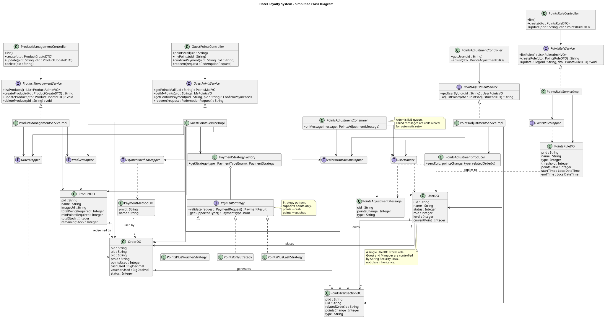

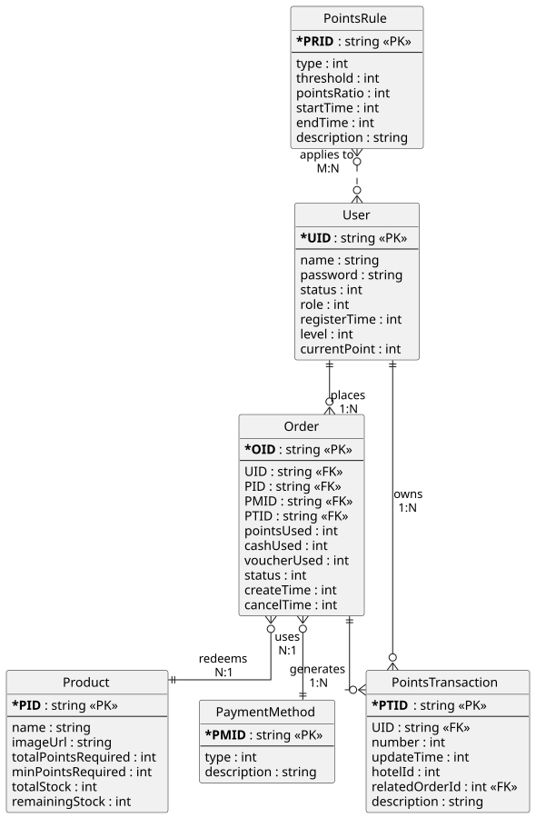

The application uses business identifiers (`uid`, `pid`, `pmid`, `oid`, `ptid`, and `prid`) in service and mapper operations. The database schema intentionally keeps foreign-key enforcement in the application layer.

---

## 7. Database Design

The database is H2 in file mode:

```text
./data/hotelloyalty
```

Schema initialization is enabled on startup. The main tables are:

```text
user
product
payment_method
order
points_transaction
points_rule
```

Important data rules:

- all tables have a generated numeric `id`;
- business identifiers have unique constraints;
- `points_change` is signed;
- `remaining_stock` is maintained separately from `total_stock`;
- `related_order_id` is nullable for non-order earnings;
- orders and points transactions keep creation and modification timestamps.

The schema is defined in [`schema.sql`](Project/hotel-loyalty/src/main/resources/schema.sql), and initial demonstration data is in [`data.sql`](Project/hotel-loyalty/src/main/resources/data.sql).

---

## 8. API and Page Endpoints

### Authentication

| Method | Endpoint | Purpose |
|---|---|---|
| GET | `/login` | Guest login page |
| GET | `/admin/login` | Manager login page |
| POST | `/auth/login` | Spring Security login processing |
| POST | `/logout` | Session logout |

### Guest pages and APIs

| Method | Endpoint | Purpose |
|---|---|---|
| GET | `/guest/{uid}/account` | Render the guest account page |
| GET | `/guest/{uid}/points-mall` | Render the guest points mall |
| GET | `/guest/{uid}/my-points` | Render balance and redemption page |
| GET | `/guest/{uid}/confirm-payment/{pid}` | Render payment confirmation |
| POST | `/guest/{uid}/redemptions` | Submit JSP redemption |
| GET | `/api/guest/{uid}/account` | Get account data |
| GET | `/api/guest/{uid}/points-mall` | Get mall data |
| GET | `/api/guest/{uid}/my-points` | Get guest points data |
| GET | `/api/guest/{uid}/confirm-payment/{pid}` | Get payment data |
| POST | `/api/guest/redemptions` | Submit REST redemption |

Guest endpoints verify that the URL or request UID matches the logged-in session identity.

### Manager pages and APIs

| Method | Endpoint | Purpose |
|---|---|---|
| GET | `/admin/products` | Product management page |
| GET | `/admin/rules` | Points-rule management page |
| GET | `/admin/points` | Manual points adjustment page |
| GET | `/api/admin/products` | List products |
| POST | `/api/admin/products` | Create product |
| GET | `/api/admin/products/{pid}` | Get product |
| PUT | `/api/admin/products/{pid}` | Update product |
| DELETE | `/api/admin/products/{pid}` | Delete product |
| GET | `/api/admin/rules` | List rules |
| POST | `/api/admin/rules` | Create rule |
| GET | `/api/admin/rules/{prid}` | Get rule |
| PUT | `/api/admin/rules/{prid}` | Update rule |
| GET | `/api/admin/points/user/{uid}` | Verify target user |
| POST | `/api/admin/points/adjustment` | Enqueue manual point adjustment |

All `/admin/**` and `/api/admin/**` routes require the manager role.

---

## 9. Security and Reliability

### Authentication and authorization

- Session-based Spring Security authentication.
- BCrypt password encoding.
- Separate guest and manager login portals.
- URL-level role-based access control.
- Guest ownership checks against `SecurityContext`.
- Explicit 30-minute session timeout.

### Data and transaction safety

- Redemption is transactional.
- Point balance updates use compare-and-update semantics.
- Stock deduction checks remaining stock in the update operation.
- Product deletion checks for active orders before deletion.
- Validation annotations are used on request DTOs.

### Asynchronous reliability

- Embedded Artemis is configured as persistent.
- Manual adjustments are queued before processing.
- Consumer exceptions trigger broker redelivery.
- Point adjustment and transaction creation are performed by the consumer.

### Current limitations

- CSRF is disabled because the current JSP JavaScript calls REST endpoints without CSRF tokens. This is acceptable for the academic prototype but should be fixed for production.
- No user-facing queue status or dead-letter workflow is exposed.
- The adjustment reason is logged but not stored in the database.
- The points-rule table is not yet connected to an external hotel-order earning flow.

---

## 10. User Interface

The UI is server-rendered using JSP and JSTL.

The two required design-time GUI prototypes are:

- [`guest_prototype_1.1.html`](GUI/guest_prototype_1.1.html), covering guest login,
  account, points mall, and redemption flow.
- [`admin_prototype_1.1.html`](GUI/admin_prototype_1.1.html), covering manager login,
  product management, points rules, and manual point adjustment.

The supporting prototype pages [`points_mall_prototype_1.1.html`](GUI/points_mall_prototype_1.1.html),
[`my_points_prototype_1.1.html`](GUI/my_points_prototype_1.1.html), and
[`confirm_payment_prototype_1.1.html`](GUI/confirm_payment_prototype_1.1.html) provide
the detailed guest screens.

| View | Purpose |
|---|---|
| `login.jsp` | Guest login |
| `admin_login.jsp` | Manager login |
| `guest_account.jsp` | Show account information |
| `guest_points_mall.jsp` | Browse products |
| `guest_confirm_payment.jsp` | Select and confirm payment |
| `guest_my_points.jsp` | Show balance and redemption records |
| `admin_products.jsp` | Product CRUD |
| `admin_points_rules.jsp` | Points rule CRUD |
| `admin_points_adjust.jsp` | Manual point award |
| `products.jsp` | Product-list demonstration page |

The working demonstration page is:

```text
http://localhost:8080/demo/products
```

The manager product page is:

```text
http://localhost:8080/admin/products
```

---

## 11. Demo Data and Running the Application

### Prerequisites

- JDK 21 or a compatible newer JDK
- Maven Wrapper included in the project

### Start the application

From the application directory:

```bash
cd Project/hotel-loyalty
./mvnw spring-boot:run
```

On Windows:

```bat
cd Project\hotel-loyalty
mvnw.cmd spring-boot:run
```

The default server address is:

```text
http://localhost:8080
```

### Build and test

```bash
cd Project/hotel-loyalty
./mvnw test
./mvnw package
```

The generated executable JAR is placed under `Project/hotel-loyalty/target/`.

### Demonstration credentials

The seed data defines:

| Role | Username | Password |
|---|---|---|
| Manager | `admin` | `admin123` |
| Guest | `guest` | `guest123` |

These credentials are for local demonstration only and must be replaced in a deployed environment.

### Useful local tools

- H2 Console: `http://localhost:8080/h2-console`
- OpenAPI JSON: `http://localhost:8080/v3/api-docs`
- Swagger UI: `http://localhost:8080/swagger-ui.html`

For the H2 console, use the JDBC URL configured in `application.yaml` and the local `sa` user.

---

## 12. Testing Status

The repository currently contains a Spring context smoke test:

```text
src/test/java/com/hotel/hotel_loyalty/HotelLoyaltyApplicationTests.java
```

The current automated suite has 103 tests covering:

1. Login, account-status, guest-ownership, and manager-role security behavior.
2. Product create, update, delete, validation, and active-order protection.
3. Points-only, points-plus-cash, and points-plus-voucher validation.
4. Minimum-point, supplement-conversion, insufficient-balance, and out-of-stock redemption.
5. Atomic balance, stock, order, and points-transaction changes.
6. Voucher redemption transaction-history linkage.
7. Manual-award queue processing and optimistic-lock retry behavior.
8. Event-driven reward distribution: `PointsDeductedEvent` publication and listener stock-deduction behavior.
9. Mapper, controller, service, state, and application-context behavior.

The suite does not yet provide browser-level end-to-end coverage for every use case, real external
payment-provider tests, points-rule calculation integration, or queue dead-letter operations.

The full suite currently passes with `./mvnw clean test`.

### Testing approach

The project uses JUnit 5 and a testing-pyramid approach organized by distance from the
business core. The intended approximate distribution is 70% unit tests, 20% integration
tests, and 10% end-to-end or system-level tests. Unit tests are fast and cover most
branches; the slower integration tests are reserved for critical paths such as the
message flow, persistence, and Spring wiring. Browser-level end-to-end coverage remains
an identified gap.

### CI/CD

CI/CD has been implemented with GitHub Actions. Pushes run the Maven verification/test
pipeline, and tagged releases package the application JAR and create a GitHub Release.
Because the project has no deployment server, continuous delivery currently ends at
automated packaging; no server deployment is performed.

---

## 13. UML and Supporting Documents

The repository contains these supporting artifacts:

| Artifact | Location |
|---|---|
| Use-case catalogue | [`Use_case_1.0.xlsx`](UseCases/Use_case_1.0.xlsx) |
| Detailed UC3 and UC6 descriptions | [`Use_Case_Description_UC3_UC6_v1.1.xlsx`](UseCases/Use_Case_Description_UC3_UC6_v1.1.xlsx) |
| Original class diagram | [`class_diagram_1.0.svg`](UML/class_diagram_1.0.svg) |
| Use-case diagram | [`all_user_case.svg`](UML/all_user_case.svg) |
| Product-management sequence diagram | [`manage_products.svg`](UML/manage_products.svg) |
| Redemption sequence diagram | [`redeem_points_for_products.svg`](UML/redeem_points_for_products.svg) |
| Order state diagram | [`order_state_diagram_1.0.svg`](UML/order_state_diagram_1.0.svg) |
| Entry relationship diagram | [`entry_relationship_diagram.svg`](UML/entry_relationship_diagram.svg) |
| Layered package architecture | [`layered_architecture.svg`](UML/layered_architecture.svg) |
| Runtime component architecture | [`component_diagram.svg`](UML/component_diagram.svg) |
| Single-host deployment topology | [`deployment_diagram.svg`](UML/deployment_diagram.svg) |
| Payment strategy UML | [`payment_strategy_uml.svg`](UML/payment_strategy_uml.svg) |
| Message-driven points adjustment | [`message_driven_points_adjustment.svg`](UML/message_driven_points_adjustment.svg) |
| Optimistic concurrency control | [`optimistic_concurrency.svg`](UML/optimistic_concurrency.svg) |
| Login Chain of Responsibility and Template Method | [`login_chain_template.svg`](UML/login_chain_template.svg) |
| Observer event extension point | [`observer_event.svg`](UML/observer_event.svg) |
| Factory and Data Mapper | [`factory_data_mapper.svg`](UML/factory_data_mapper.svg) |
| MVC and dependency injection | [`mvc_dependency_injection.svg`](UML/mvc_dependency_injection.svg) |
| Design principles evidence | [`design_principles.svg`](UML/design_principles.svg) |
| Database schema | [`schema.sql`](Project/hotel-loyalty/src/main/resources/schema.sql) |

The latest assignment documents used to update this report are:

| Topic | Source document |
|---|---|
| Software lifecycle | [`3.2 lifecycle discussion`](Document/3.2%20A%20two-page%20%28maximum%29%20discussion%20on%20the%20software%20lifecycle%20adopted%20with%20a%20paragraph%20on%20resolution%20of%20tension%20between%20managemen.docx) |
| System architecture | [`5.0 architecture discussion`](Document/5.0%20A%20two-page%20%28maximum%29%20discussion%20of%20system%20architecture%20to%20include%20two%20architectural%20patterns%20and%20%20high-level%20pack.docx) |
| Package/class/LOC evidence | [`7.1`](Document/7.1%20A%20table%20listing%20the%20packages%2C%20%23%20classes%20per%20package%2C%20and%20the%20total%20packages%20and%20classes..xlsx), [`7.2`](Document/7.2%20A%20table%20listing%20the%20classes%20in%20each%20package%2C%20their%20authors%2C%20and%20lines%20of%20code..xlsx), [`7.3`](Document/7.3%20A%20table%20listing%20total%20lines%20of%20code%20implemented%20by%20each%20team%20member.xlsx) |
| MVC and architectural patterns | [`8.1`](Document/8.1%20Model-View-Controller%20%28MVC%29%20REST%20Architectural%20Pattern%2C%20and%20the%20Other%20Architectural%20Patterns%20Implemented.docx) |
| Automated testing | [`8.4`](Document/8.4%20Automated%20testing%20using%20JunitNunitother.docx) |
| CI/CD | [`9.1`](Document/9.1%20CICD.docx) |
| Four design patterns | [`Four Design Patterns Implemented`](Document/Four%20Design%20Patterns%20Implemented.docx) |
| Generative-AI prompt list | [`Prompt list`](Document/List%20of%20prompts%20used%20in%20Generative%20AI%20platform%28s%29.docx) |
| Design and implementation critique | [`Critique`](Document/One%20page%20%28maximum%29%20critique%20on%20the%20quality%20of%20the%20design%20and%20implementation%20with%20a%20paragraph%20on%20the%20utility%20of%20diagrams%2C%20the%20eff.docx) |

The original UML assets describe the conceptual design and should be read together with the current implementation notes in this report. In particular:

- the running code uses one `UserDO` with role-based security rather than Java `Guest` and `Manager` subclasses;
- payment methods are stored as database records while payment validation is implemented through `PaymentStrategy`;
- the current guest page shows both redemption records and the full points transaction history;
- order-state classes exist; the redemption service uses them to validate the pay transition, and cancellation/fulfilment workflows remain to be connected.

---

## 14. Implementation Gaps and Recommended Next Steps

> Reviewed against the current code on 27 October 2026. All four gaps below are still open.

### Priority 1: **[Key gap]** Connect points rules to earning

`PointsRuleServiceImpl` only performs CRUD on rules, and `PointsRuleMapper.selectByTypeAndThreshold` is not called by any main-code flow. Introduce an external-order earning service that picks an applicable `PointsRuleDO`, calculates the points from the ratio, and sends the resulting earning event through the existing adjustment/message mechanism.

### Priority 2: **[Key gap]** Add operational queue management

`PointsAdjustmentMessage` carries no reason and no durable request ID, `points_transaction` has no reason column, the reason is only written to the application log, and `JmsConfig` defines no dead-letter queue. Persist the manual-adjustment reason, add a durable request identifier, and expose queued, processed, retrying, and permanently failed states with dead-letter administration.

### Priority 3: **[Partially complete]** Make product availability explicit

`ProductVO` only exposes `pid`, `name`, `imageUrl`, and `totalPointsRequired`; `getPointsMall` filters products through `selectAvailable()`. The backend filters out-of-stock products, but the guest-facing model should expose availability and stock status explicitly where the use case requires it.

### Priority 4: **[Partially complete]** Complete order lifecycle parity

The redemption service now validates the pay transition through `OrderContext` and persists it with a compare-and-update, but `OrderContext.cancel()` and `complete()` are not called by any workflow. Connect the existing order-state classes to cancellation, fulfilment, and shipment workflows. UC1 account viewing is complete; the remaining gap is order lifecycle behavior, not account data.

### Test coverage status

The current automated suite contains 103 tests, all passing with `./mvnw clean test`; the covered
areas are listed in section 12.

---

## 15. Conclusion

The current project is a working academic prototype of a hotel loyalty points mall. Its strongest implemented areas are the core redemption transaction, role-based manager/guest separation, product CRUD, strategy-based payment validation, and asynchronous manual point adjustment.

The main differences between the original design documents and the current code are implementation-level rather than architectural: the application uses role-based persistence instead of user inheritance, strategy classes instead of payment-method subclasses, and service/mapper layers instead of domain objects containing all behavior.

The next meaningful step is to show product availability more explicitly and connect managed points rules to an actual points-earning workflow. Once those are implemented and covered by browser-level tests, the project will have much stronger traceability from the use-case catalogue through the UML artifacts to the running application.

---

## 16. Technology Stack and Technical References

This section identifies the technologies used by the implemented system and the role of
each technology in the solution.

| Area | Technology | Use in this project |
|---|---|---|
| Language/runtime | Java 21 | Application source, domain objects, services, tests, and build target |
| Application framework | Spring Boot 4.0.8 | Application bootstrapping, auto-configuration, dependency management, and embedded server |
| Web layer | Spring MVC / WebMVC | REST controllers, page controllers, request binding, validation, and exception handling |
| Presentation | JSP, JSTL, HTML, CSS, JavaScript | Server-rendered guest and manager pages and browser-side API calls |
| Security | Spring Security, BCrypt | Session authentication, guest/manager role-based authorization, password hashing, and ownership checks |
| Persistence | MyBatis 4.0.1 | Data Mapper interfaces and SQL-backed access to the application tables |
| Database | H2 Database | Local file-mode relational database for development, demonstration, and automated tests |
| Messaging | Jakarta Messaging (JMS), embedded Apache ActiveMQ Artemis | Persistent queue and asynchronous processing of manager point adjustments |
| API documentation | Springdoc OpenAPI 3.1.1, Swagger UI | OpenAPI 3 document and interactive API documentation |
| Validation | Jakarta Bean Validation / Spring Boot validation | DTO constraints and fail-fast request validation |
| Build | Apache Maven and Maven Wrapper | Reproducible dependency resolution, compilation, testing, and packaging |
| Testing | JUnit 5, Spring Boot test support, Spring Security Test, MyBatis test support | Unit, integration, controller, security, service, mapper, and context tests |
| Code generation | Lombok | Reduced boilerplate for selected Java model and service classes |
| Modelling | UML/SVG, Excel use-case and candidate-object workbooks | Requirements, class, sequence, state, component, deployment, package, and data-model communication |
| Version control | Git and GitHub | Source history, collaboration, traceability, and version-control evidence |

The implementation is intentionally a single deployable Spring Boot application. H2 and
embedded Artemis keep the academic prototype self-contained; they are replaceable
infrastructure choices rather than business-domain dependencies.

### Technology and theory references

The implementation and design discussion are grounded in the five references listed in
Section 25. The correspondence is:

- **Architecture and quality attributes:** Bass, Clements, and Kazman.
- **Strategy, State, Observer, Factory, and Chain of Responsibility:** Gamma et al.
- **MVC, Data Mapper, and transaction-script/service-layer separation:** Fowler.
- **Spring MVC, dependency injection, Spring Security, and Spring Boot:** Walls.
- **Agile lifecycle, principles, and the complexity/agility trade-off:** Martin.

The online framework documentation used for implementation verification is linked in the
technology table where appropriate; it is not counted as part of the formal five-item
reference list.

---

## 17. Assignment Deliverables and Traceability Matrix

The following matrix converts the supplied assignment workbook into a report-ready
submission checklist. “Evidence” links to the current repository artifact; “status” is
the state of the evidence in this repository, not a claim that every optional extension
has been implemented.

| Assignment item | Required report output | Evidence in this repository | Status |
|---|---|---|---|
| 3.1 Business scenario | Maximum one-page narrative | Section 1; [`3.1 business scenario`](Document/3.1%20A%20one-page%20%28maximum%29%20narrative%20description%20of%20your%20business%20scenario.docx) | Complete |
| 3.2 Software lifecycle | Maximum two-page lifecycle discussion and complexity/agility tension | [`3.2 lifecycle discussion`](Document/3.2%20A%20two-page%20%28maximum%29%20discussion%20on%20the%20software%20lifecycle%20adopted%20with%20a%20paragraph%20on%20resolution%20of%20tension%20between%20managemen.docx); Section 18 | Complete |
| 3.3 Project plan | Scope, ownership, schedule, dependencies, and completion evidence | [`Project plan`](Plan/-v1.0-3-10-2026.xlsx), [`final plan screenshot`](Plan/Final%20Plan.png); Section 19 | Complete |
| 4.1 Requirements | Use-case diagram and two detailed key use cases | [`Use-case diagram`](UML/all_user_case.svg); [`UC3 and UC6 descriptions`](UseCases/Use_Case_Description_UC3_UC6_v1.1.xlsx); Section 3 | Complete |
| 4.2 Quality attributes | At least one “-ility” must be extensibility, plus quality tactics | Section 20; Sections 5 and 9 | Complete |
| 4.3 GUI prototypes | Two GUI prototypes and explanation of user flow | [`GUI prototypes`](GUI/); actual running screenshots in Section 10 | Complete |
| 5.0 Architecture | Maximum two-page architecture discussion, two architectural patterns, and a high-level package view | [`Architecture discussion`](Document/5.0%20A%20two-page%20%28maximum%29%20discussion%20of%20system%20architecture%20to%20include%20two%20architectural%20patterns%20and%20%20high-level%20pack.docx); Sections 4 and 5; [`package diagram`](UML/package_diagram.svg) | Complete |
| 6.1–6.5 Design sketches | Candidate objects, class, sequence/communication, state, and ER diagrams | [`Candidate objects`](Document/candidate_objects_1.0.xlsx); [`UML assets`](UML/); Section 13 | Complete |
| 7.1–7.4 Transparency | Package/class counts, authorship and LOC, team contribution, patterns/testing/CI-CD ownership | [`7.1 package counts`](Document/7.1%20A%20table%20listing%20the%20packages%2C%20%23%20classes%20per%20package%2C%20and%20the%20total%20packages%20and%20classes..xlsx), [`7.2 class authorship and LOC`](Document/7.2%20A%20table%20listing%20the%20classes%20in%20each%20package%2C%20their%20authors%2C%20and%20lines%20of%20code..xlsx), [`7.3 team LOC`](Document/7.3%20A%20table%20listing%20total%20lines%20of%20code%20implemented%20by%20each%20team%20member.xlsx); Section 21 (includes 7.4 planned-versus-actual table) | Complete |
| 8.1–8.4 Code evidence | MVC/REST, four patterns, key use cases, and automated testing snippets | [`8.1 MVC and architectural patterns`](Document/8.1%20Model-View-Controller%20%28MVC%29%20REST%20Architectural%20Pattern%2C%20and%20the%20Other%20Architectural%20Patterns%20Implemented.docx), [`four design patterns`](Document/Four%20Design%20Patterns%20Implemented.docx), [`8.4 automated testing`](Document/8.4%20Automated%20testing%20using%20JunitNunitother.docx), Sections 4 and 5 (code snippets included), Sections 8 and 12; `src/main/java`; `src/test/java` | Complete |
| 8.5 Version control | Visual evidence of version-control use | Git repository: <https://github.com/fordringd2008/CS6451-Advanced-software-design>; [`version-control visualisation`](Document/Visualisations%20that%20show%20use%20of%20version%20control.png); [`tag versions`](Document/tag%20versions.png) | Complete |
| 9 Added value | Additional design or implementation value | Sections 5.4–5.10, 9, and 20; [`9.1 CI/CD`](Document/9.1%20CICD.docx) | Complete |
| 10 Recovered architecture | Design-time package, component, and deployment blueprints | [`package diagram`](UML/package_diagram.svg), [`component diagram`](UML/component_diagram.svg), [`deployment diagram`](UML/deployment_diagram.svg) | Complete |
| 11 Critique | Maximum one-page critique of design and implementation quality | [`Critique`](Document/One%20page%20%28maximum%29%20critique%20on%20the%20quality%20of%20the%20design%20and%20implementation%20with%20a%20paragraph%20on%20the%20utility%20of%20diagrams%2C%20the%20eff.docx); Section 22 | Added |
| 12 Reflection | A section entitled “Reflection” with a learning account for each team member | Section 23 | Fordring drafted; Franklin entry requires confirmation |
| 13 AI list | List of prompts and generative-AI platforms used | [`Prompt list`](Document/List%20of%20prompts%20used%20in%20Generative%20AI%20platform%28s%29.docx); Section 24 | Complete for the archived prompt list |
| 14 References | Academic and technical references | Section 16 and Section 25 | Added |

For final export, the report should retain sections 1–25 in order and include the linked
SVG diagrams as figures or an appendix. The assignment page limits apply to the named
subsections, not to the evidence appendix.

### 8.5 Version-control evidence

The following images document the project's use of Git and GitHub for source history,
collaboration, traceability, and tagged versions:


---

## 18. Software Lifecycle Discussion

The project adopted a **Waterfall lifecycle**. Requirements were confirmed and frozen at
the start, and the chance of later changes was considered low. Feedback was collected at
fixed review points: requirements were reviewed in Week 5, design was completed during
Weeks 5–6, and coding began from Week 7. A two-person team could communicate directly, so
formal Agile ceremonies such as daily stand-ups would have added cost without enough
benefit.

The team considered RUP but did not adopt it. RUP repeats analysis and design through
multiple iterations and is better suited to large or high-risk systems requiring formal
tracking and audits. This project has stable requirements, two team members, and no
external audit requirement, so RUP's additional process would add effort without
proportionate value.

The main tension was between **management of complexity and agility**. For this small,
simple project, heavy documentation and strict process would slow delivery while adding
little practical value. The team resolved the tension with a lightweight Waterfall
approach: work in a clear sequence, keep only the communication and records needed for
the assignment, and avoid process overhead that does not address a real project risk.

---

## 19. Project Plan Summary

The project plan divides work across requirements, architecture, GUI, coding, testing,
documentation, and final review. The dependency order used by the project is:

```text
Business scenario and use cases
        -> candidate objects and GUI prototypes
        -> architecture and UML
        -> implementation
        -> automated tests and traceability
        -> critique, reflection, AI list, and final references
```

The implementation evidence is organized around six use cases: UC1 login/account,
UC2 points history, UC3 product redemption, UC4 points rules, UC5 manual point award,
and UC6 product management. UC3 and UC6 are the two key use cases with detailed
spreadsheet descriptions. The current schedule and named ownership remain in
[`-v1.0-3-10-2026.xlsx`](Plan/-v1.0-3-10-2026.xlsx); this README supplies the narrative
that connects the plan to the delivered artifacts.

### Roles, responsibilities, deadlines, and deliverables

The final plan assigns work by deliverable and uses Week 5–Week 8 milestones:

| Team member | Role and contribution | Main deadlines | Deliverables |
|---|---|---|---|
| Fordring | Requirements lead, use-case analyst, UML/sketch contributor, implementation contributor, and final-report contributor | Week 5: scenario, use cases, quality attributes; Week 6: class/state/ER sketches; Week 7: coding and version-control evidence; Week 8: references and final review | Business scenario, use-case catalogue and key-use-case evidence, quality-attribute evidence, candidate objects, class/state/ER sketches, coding contribution, final references |
| Franklin | Lifecycle and architecture lead, GUI contributor, transparency/testing/CI-CD contributor, implementation contributor, and critique contributor | Week 5: lifecycle, GUI, architecture; Week 7: package/class/LOC evidence, patterns, automated testing, CI/CD, critique, coding; Week 8: reflection | Lifecycle discussion, GUI prototypes, architecture and package evidence, transparency tables, pattern/testing/CI-CD evidence, critique, coding contribution, reflection |
| Both | Joint implementation, integration, review, and final consistency checking | Weeks 7–8 | Working Spring Boot application, tests, final report, and submission review |

The plan is iterative at the evidence level: requirements and sketches were reviewed
before implementation, implementation findings were fed back into the UML and gap
notes, and tests and the final critique were used to revise the report before export.

### Industry experience

The supplied project files do not contain verified employment or industry-experience
details for either team member. The required table is included below so that the
official information can be added without inventing credentials:

| Team member | Industry domain(s) | Programming languages | Frameworks/tools | Evidence/status |
|---|---|---|---|---|
| Fordring | Not documented in the repository | Java, HTML/CSS/JavaScript are evidenced by this project | Spring Boot, Spring MVC, MyBatis, JUnit, Git/GitHub | Project experience evidenced; external industry experience requires confirmation |
| Franklin | Not documented in the repository | Java, HTML/CSS/JavaScript are evidenced by this project | Spring Boot, Spring MVC, MyBatis, JUnit, GitHub Actions | Project experience evidenced; external industry experience requires confirmation |

### Final project plan


This image is the final project-plan snapshot and complements the underlying workbook.

### Project diary (Week 4–12)

The diary records the weekly contribution, problems encountered, and next-week plan.
Weeks 4–9 are reconstructed from the Git commit history and the team discussion log;
Weeks 10–12 are the remaining plan at the time of writing.

| Week | Dates | Contribution | Problems encountered | Next week plan |
|---|---|---|---|---|
| 4 | 28 Sep – 4 Oct | Discussed the business scenario; identified UC1–UC6; designed domain-object fields (User, PointsTransaction, Product, PointsRule, PaymentMethod); created project plan v1.0; initialized the Git repository | Use-case boundaries were ambiguous; the "threshold" in the points rule was understood differently by the two members | Freeze the use cases; draw the use-case diagram |
| 5 | 5 – 11 Oct | Wrote the use-case catalogue and use-case diagram v1.0/v1.1; detailed the two key use cases (UC3, UC6); added the discussion log | Use-case description granularity was inconsistent between members | Build GUI prototypes aligned to the use cases |
| 6 | 12 – 18 Oct | Created four GUI prototype pages (admin, confirm-payment, my-points, points-mall); released GUI v1.1 with a changelog; added `.gitignore` | Prototypes contained UI elements not backed by any use case; several refinement rounds were needed | Architecture design and Spring Boot scaffolding |
| 7 | 19 – 25 Oct | Added the Spring Boot project (JDK 21, Artemis embedded); implemented the core (layered code, state machine, payment strategy, JMS, Swagger UI, JSP demo); login security with Chain of Responsibility; class diagram 1.0; full test suite — 98 tests | Login page returned HTTP 500; successful login did not redirect to the account page; logout link used GET but Spring Security requires POST; favicon.ico NoResourceFoundException | Add payment simulation, CI/CD, and UML evidence |
| 8 | 26 Oct – 1 Nov | Mixed payment support (points+cash, points+voucher); activated `PointsDeductedEvent` with the stock-deducting listener; CI/CD workflows; architecture and design-pattern UML diagrams; demo PDF; reflection drafts and reference list | Third payment type redemption did not update correctly; product image URL field was too short (fixed to 2048 chars) | Archive deliverables and sync documentation |
| 9 | 2 – 8 Nov | Archived assignment deliverables (docx/xlsx); synced the test and docs with the event-driven design; added the final plan and real GUI screenshots | Test and documentation had drifted from the event-driven design change | Final review and PDF export |
| 10 | 9 – 15 Nov | *(planned)* Final consistency review; export README to PDF with SVG figures rendered | — | Prepare the submission package |
| 11 | 16 – 22 Nov | *(planned)* Verify page limits, transparency tables, and the submission checklist | — | Submit |
| 12 | 23 – 29 Nov | *(planned)* Submission window | — | — |

---

## 20. Quality Attributes and Quality Tactics

The project treats the following qualities as architectural concerns:

| Quality attribute | Tactics and implementation evidence |
|---|---|
| Extensibility | Strategy interfaces for payment, state objects for order lifecycle, event listeners for reward distribution, mapper/service interfaces, and dependency injection |
| Security | Session authentication, role-based URL rules, BCrypt, generic login errors, explicit account-status checks, and guest ownership validation |
| Reliability | Transactional redemption, conditional balance/stock updates, persistent Artemis messaging, retry on message-processing conflicts, and failure-visible implementation-gap documentation |
| Modifiability | Layered separation of controllers, services, mappers, and views; focused DTOs/VOs; constructor injection; isolated payment and messaging abstractions |
| Performance | Database-side conditional updates, filtered available-product queries, and asynchronous manual point adjustment |
| Testability | Constructor injection, service boundaries, mapper abstractions, Spring test slices, security test support, and a test pyramid with fast unit tests around the business core |
| Auditability | Signed points transactions, related order identifiers, timestamps, role checks, and explicit domain/application boundaries |

The main trade-off is that the prototype favors local reproducibility over production
scale: H2 and embedded Artemis reduce setup cost, while a production deployment would
normally use a managed relational database, an external broker, CSRF protection, and
external payment providers.

---

## 21. Transparency and Traceability

The traceability chain is:

```text
Assignment requirement
    -> use case / quality attribute
    -> UML or GUI artifact
    -> controller/service/mapper implementation
    -> automated test
    -> known gap or completion status
```

The following archived statistics come from the supplied 7.1–7.3 workbooks and describe
the commit that added those workbooks. They are retained as submission evidence rather
than regenerated from the current working tree.

### 7.1 Package and class counts

| Package | Description | Classes |
|---|---|---:|
| `com.hotel.hotel_loyalty` | Spring Boot entry point | 1 |
| `.common` | Shared utilities and exception handling | 3 |
| `.config` | Security and JMS configuration | 2 |
| `.controller` | REST and JSP controllers | 10 |
| `.domain` | Database table data objects | 6 |
| `.dto` | Inbound request payloads | 6 |
| `.enums` | Type-safe enumerations | 6 |
| `.mapper` | MyBatis data access mappers | 6 |
| `.messaging` | Events and JMS messages | 5 |
| `.order` | Order state machine | 6 |
| `.payment` | Payment strategy pattern | 8 |
| `.security` | Login and authorization handlers | 11 |
| `.service` | Business service interfaces | 4 |
| `.service.impl` | Business service implementations | 4 |
| `.vo` | Outbound response view objects | 11 |
| **Total** | **15 packages** | **89** |

### 7.2 Class authorship and lines of code

| Package | Class | Author | LOC |
|---|---|---|---:|
| `com.hotel.hotel_loyalty` | `HotelLoyaltyApplication` | wukewei | 23 |
| `common` | `DateTimeDisplayFormatter` | Fordring | 23 |
| `common` | `GlobalExceptionHandler` | wukewei | 78 |
| `common` | `Result` | wukewei | 41 |
| `config` | `JmsConfig` | wukewei | 51 |
| `config` | `SecurityConfig` | wukewei | 112 |
| `controller` | `AdminPointsController` | wukewei | 30 |
| `controller` | `AdminPointsRuleController` | wukewei | 31 |
| `controller` | `AdminProductController` | wukewei | 40 |
| `controller` | `AuthJspController` | wukewei | 34 |
| `controller` | `DemoJspController` | wukewei | 36 |
| `controller` | `GuestJspController` | Fordring | 155 |
| `controller` | `GuestPointsController` | Fordring | 103 |
| `controller` | `PointsAdjustmentController` | wukewei | 53 |
| `controller` | `PointsRuleController` | wukewei | 70 |
| `controller` | `ProductManagementController` | wukewei | 83 |
| `domain` | `OrderDO` | wukewei | 60 |
| `domain` | `PaymentMethodDO` | wukewei | 42 |
| `domain` | `PointsRuleDO` | wukewei | 60 |
| `domain` | `PointsTransactionDO` | wukewei | 51 |
| `domain` | `ProductDO` | wukewei | 48 |
| `domain` | `UserDO` | wukewei | 53 |
| `dto` | `PointsAdjustDTO` | wukewei | 30 |
| `dto` | `PointsAdjustmentDTO` | wukewei | 28 |
| `dto` | `PointsRuleDTO` | wukewei | 48 |
| `dto` | `ProductCreateDTO` | wukewei | 41 |
| `dto` | `ProductUpdateDTO` | wukewei | 54 |
| `dto` | `RedemptionRequest` | Fordring | 44 |
| `enums` | `OrderStatusEnum` | wukewei | 59 |
| `enums` | `PaymentTypeEnum` | wukewei | 98 |
| `enums` | `PointsRuleTypeEnum` | wukewei | 57 |
| `enums` | `UserLevelEnum` | wukewei | 60 |
| `enums` | `UserRoleEnum` | wukewei | 51 |
| `enums` | `UserStatusEnum` | wukewei | 54 |
| `mapper` | `OrderMapper` | wukewei | 52 |
| `mapper` | `PaymentMethodMapper` | wukewei | 27 |
| `mapper` | `PointsRuleMapper` | wukewei | 46 |
| `mapper` | `PointsTransactionMapper` | wukewei | 34 |
| `mapper` | `ProductMapper` | wukewei | 60 |
| `mapper` | `UserMapper` | wukewei | 54 |
| `messaging` | `PointsAdjustmentConsumer` | wukewei | 76 |
| `messaging` | `PointsAdjustmentMessage` | wukewei | 43 |
| `messaging` | `PointsAdjustmentProducer` | wukewei | 38 |
| `messaging` | `PointsDeductedEvent` | wukewei | 43 |
| `messaging` | `RewardDistributionListener` | wukewei | 36 |
| `order` | `CancelledState` | wukewei | 37 |
| `order` | `CompletedState` | wukewei | 37 |
| `order` | `OrderContext` | wukewei | 76 |
| `order` | `OrderState` | wukewei | 32 |
| `order` | `PaidState` | wukewei | 39 |
| `order` | `PendingPaymentState` | wukewei | 37 |
| `payment` | `PaymentAmountCalculator` | Fordring | 24 |
| `payment` | `PaymentRequest` | wukewei | 39 |
| `payment` | `PaymentResult` | wukewei | 31 |
| `payment` | `PaymentStrategy` | wukewei | 22 |
| `payment` | `PaymentStrategyFactory` | wukewei | 49 |
| `payment` | `PointsOnlyStrategy` | wukewei | 37 |
| `payment` | `PointsPlusCashStrategy` | wukewei | 48 |
| `payment` | `PointsPlusVoucherStrategy` | wukewei | 49 |
| `security` | `AppUserDetailsService` | wukewei | 92 |
| `security` | `LoginContext` | wukewei | 36 |
| `security` | `LoginFailureHandler` | wukewei | 39 |
| `security` | `LoginLogHandler` | wukewei | 26 |
| `security` | `LoginPostHandler` | wukewei | 55 |
| `security` | `LoginSuccessHandler` | wukewei | 70 |
| `security` | `PortalAwareAuthenticationEntryPoint` | wukewei | 37 |
| `security` | `PortalAwareLogoutSuccessHandler` | wukewei | 36 |
| `security` | `PortalMatchHandler` | wukewei | 27 |
| `security` | `RedirectHandler` | wukewei | 23 |
| `security` | `StatusCheckHandler` | wukewei | 23 |
| `service` | `GuestPointsService` | Fordring | 60 |
| `service` | `PointsAdjustmentService` | wukewei | 38 |
| `service` | `PointsRuleService` | wukewei | 39 |
| `service` | `ProductManagementService` | wukewei | 47 |
| `service.impl` | `GuestPointsServiceImpl` | Fordring | 329 |
| `service.impl` | `PointsAdjustmentServiceImpl` | wukewei | 86 |
| `service.impl` | `PointsRuleServiceImpl` | wukewei | 133 |
| `service.impl` | `ProductManagementServiceImpl` | wukewei | 162 |
| `vo` | `AccountVO` | wukewei | 47 |
| `vo` | `ConfirmPaymentVO` | wukewei | 36 |
| `vo` | `MyPointsVO` | wukewei | 39 |
| `vo` | `PaymentMethodVO` | wukewei | 19 |
| `vo` | `PointsHistoryVO` | wukewei | 36 |
| `vo` | `PointsMallVO` | wukewei | 21 |
| `vo` | `ProductAdminVO` | wukewei | 36 |
| `vo` | `ProductVO` | wukewei | 25 |
| `vo` | `RedemptionRecordVO` | wukewei | 49 |
| `vo` | `RuleAdminVO` | wukewei | 43 |
| `vo` | `UserPointsVO` | wukewei | 29 |

### 7.3 Team contribution

| Team member | Classes | LOC | Share |
|---|---:|---:|---:|
| wukewei | 82 | 3,966 | 84.4369% |
| Fordring | 7 | 731 | 15.5631% |
| **Total** | **89** | **4,697** | **100%** |

### 7.4 Planned versus actual division of work

Franklin is the git author "wukewei" in tables 7.2 and 7.3. The table below maps each
deliverable area to its planned owner (Section 19) and the actual contribution evidenced
in the repository.

| Deliverable area | Planned owner | Actual contribution | Evidence |
|---|---|---|---|
| Business scenario and use cases | Fordring | Scenario narrative; UC1–UC6 catalogue; two key use-case descriptions (UC3, UC6) | Section 1; Section 3; UseCases/ |
| Lifecycle and architecture documents | Franklin | 3.2 lifecycle discussion; 5.0 architecture discussion | Document/ |
| GUI prototypes | Franklin | Four prototype pages v1.1 (admin, points-mall, my-points, confirm-payment) with changelog | GUI/ |
| Design sketches (candidate objects, class, state, ER) | Fordring | Candidate-object workbook; class, state, and ER sketches | Document/candidate_objects_1.0.xlsx; UML/ |
| Architecture and design-pattern UML | Franklin | Layered, package, component, deployment, strategy, factory, chain, observer, and message-driven SVG diagrams | UML/ |
| Project scaffolding and boilerplate | Franklin | domain, dto, vo, enums, mapper, and config classes — one set per database table | Section 7.2 |
| Core business logic | Fordring | `GuestPointsServiceImpl` (329 LOC, largest single class), `GuestPointsController`, `GuestJspController`, `PaymentAmountCalculator`, `RedemptionRequest` | Section 7.2 |
| Security (Chain of Responsibility login) | Franklin | `security` package, 11 classes, login validation chain | Section 5.6; Section 7.2 |
| Automated tests and CI/CD | Franklin | Test suite (103 tests); `ci.yml` and `release.yml` workflows | Section 12; .github/workflows/ |
| Transparency workbooks and code-snippet documents | Franklin | 7.1–7.3 workbooks; 8.1/8.2/8.4 code-snippet documents; 9.1 CI/CD document | Document/ |
| Reflection and final report | Both | Individual reflections; joint final consistency review | Section 23 |

The LOC distribution in 7.3 (84.4% versus 15.6%) reflects the code-internal division of
labor, not unequal contribution. One member owned the project scaffolding — domain, DTO,
VO, enum, and mapper classes, one set per database table, which naturally produces a high
class and LOC count — together with the security chain, the automated tests, and the
CI/CD pipeline. The other member owned the core business logic, including the largest
single class in the project, and was responsible for requirements analysis, UML design
sketches, and the final report. Requirements, UML, documentation, and review are real
project work but are not counted in the LOC statistic. Both members contributed
substantially; LOC share is not a measure of contribution share.

The endpoint-to-use-case mapping remains in Section 8, and the test-to-behavior summary
is in Section 12. These archived counts should not be presented as a fresh count if the
source tree changes after the documented commit.

---

## 22. Critique of Design and Implementation

The design is mostly solid, but several features remain unfinished. Controllers do not
access mappers directly, services do not call each other, and the layered MVC structure
keeps responsibilities clear. The payment strategies and login validation chain are
small and independently testable. Optimistic locking prevents concurrent balance or
stock updates from overwriting one another. Unit tests cover the strategies and chain,
while integration tests exercise the message flow with Artemis and H2; CI runs the
automated tests on every push.

The main weaknesses are in the incomplete event-driven and operational features. There
is no dead-letter queue, so messages that exhaust all retries are not administratively
recoverable. The reward-distribution listener deducts stock inside the redemption
transaction, but no real external delivery (e-mail confirmation, shipment, or voucher
issuance) or guest notification is implemented yet. The queue architecture is prepared for batch
issuing, but no batch-issuing endpoint exists and the 10,000-user scenario has not been
tested. These limits are acceptable for an academic prototype but must be addressed for
production use.

### Utility of diagrams

The UML diagrams are useful implementation guides: the class, layered-package, and
pattern diagrams closely match the package structure, and the use-case diagrams helped
derive controller endpoints and test scenarios. Their limitation is that they are
static and cannot be automatically checked against source code. For example, the
order-state diagram describes a `refundPoints()` operation that is not present in the
implementation. The diagrams should therefore document the main flows, omit details
that change frequently, and be reviewed whenever the code changes.

---

## 23. Reflection

### Fordring

This project taught me how Chain of Responsibility, Observer, Strategy, and State
patterns are used in a real application rather than only in isolated examples. I also
studied Spring Boot MVC, layered architecture, security, persistence, and asynchronous
processing in more depth. During requirements confirmation, discussion of the key use
cases revealed ambiguity and caused part of the work to be restarted, which affected
the schedule. The team recovered by prioritizing the clarified use cases, working
through the implementation and test evidence, and bringing the schedule back on track.
The main lesson is that early use-case agreement is not administrative overhead: it is
a technical dependency for architecture, implementation, and testing.

### Franklin

What I learned

The most important thing I learned is the value of setting rules first. At the start, we wrote the architecture document, the coding standards (based on the Alibaba Java Development Manual), and the test strategy. When problems came up, we went back to these rules, found the cause, and improved the rules.

For example, the first version of selectAll() did not filter out items with no stock. We missed this while coding. Before writing the tests, we checked the code against the UC3 sequence diagram and found it. So the rules helped us find a mistake that the code alone did not show.

Project value

We worked in a “rules first” way: documents and standards came before the code, and the test strategy came before the tests.

What worked

Setting rules first for the “how” part, such as UML and the test strategy, gave us a clear base for later work.

What did not work

We drew the GUI prototypes for the “what” part too late, after the design phase. As a result, the team understood some requirements differently, such as what the “threshold” in the points rule meant. The lesson is to draw prototypes before the design, so everyone agrees on what we are building before we decide how.

---

## 24. Generative AI Use

The team used Copilot, DeepSeek V4 Flash, Qwen3-Coder 30B, and JoyAI Code 1.6 as
engineering assistants. Human team members retained responsibility for requirements,
verification, source-code decisions, and the final report.

| # | Task | Representative prompt | AI output | Human action |
|---:|---|---|---|---|
| 1 | CI/CD setup | “This GitHub assignment project has no server. How can we add CI/CD?” | `ci.yml` for push-to-Maven verification and `release.yml` for tag-to-JAR/GitHub Release | Chose branch and trigger rules; fixed a token-scope failure and a test failure; changed the test assertion |
| 2 | UML audit | “Check which UML diagrams are valid and match the code.” | Audited 15 diagrams; 9 matched and 6 had discrepancies such as incorrect class names, outdated claims, or incorrect SQL | Verified each finding against source code before accepting it |
| 3 | Test code | “Fix the failing PointsAdjustmentMessagingTest.” | Revised the test to assert that stock decreases by one, matching the listener-deducts-stock event-driven design | Confirmed the design intent and changed the test rather than the implementation |
| 4 | Concept explanations | “What does git tag mean?” and “How does GitHub Actions CI work?” | Explained Git tags and GitHub Actions CI | Used the explanations to improve understanding, then executed commands manually |

Secrets, credentials, and unnecessary private data must not be included in the prompt
history.

---

## 25. References and Submission Checklist

### Formal reference list

1. Bass, Len, Paul Clements, and Rick Kazman (2013). *Software Architecture in
   Practice* (3rd ed.). Addison-Wesley. Used for architectural drivers, quality
   attributes, tactics, and architecture evaluation.
2. Gamma, Erich, Richard Helm, Ralph Johnson, and John Vlissides (1994). *Design
   Patterns: Elements of Reusable Object-Oriented Software*. Addison-Wesley. Used for
   Strategy, State, Observer, Factory, and Chain of Responsibility patterns.
3. Fowler, Martin (2002). *Patterns of Enterprise Application Architecture*.
   Addison-Wesley. Used for MVC, service-layer separation, Data Mapper, and enterprise
   application structuring.
4. Walls, Craig (2022). *Spring in Action* (6th ed.). Manning Publications. Used for
   Spring Boot, Spring MVC, dependency injection, web security, and application
   configuration.
5. Martin, Robert C. (2002). *Agile Software Development: Principles, Patterns, and
   Practices*. Prentice Hall. Used for the lifecycle discussion, iterative refinement,
   SOLID principles, and the balance between complexity management and agility.

The repository files, UML diagrams, use-case workbooks, and GitHub history are project
evidence rather than bibliographic references. They are cited in the traceability matrix
and supporting-artifact sections above.

### Final export checklist

- [ ] Confirm the two page-limited discussions meet their page limits.
- [ ] Insert the two detailed key-use-case descriptions and the required diagrams.
- [ ] Refresh package/class/LOC/authorship tables from the final commit.
- [ ] Add the required version-control screenshots, if the marking format requires images.
- [ ] Replace the Franklin reflection placeholder with the team member's own account.
- [ ] Append the final AI prompt list and verify that it contains no secrets.
- [ ] Run `./mvnw clean test` and record the final test result and test count.
- [ ] Review all “gap” labels so planned work is not presented as implemented behavior.
- [ ] Export this README to PDF/HTML with SVG figures rendered and links preserved.
